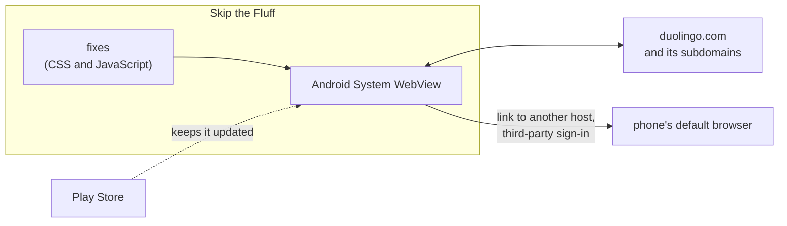

# ADR-0001: The website is shown in Android's own WebView

- **Status:** Proposed
- **Date:** 2026-11-08
- **Decided by:** Thomas, 8 November 2026, in conversation, on Claude's brief

## Context

Skip the Fluff needs a component that draws [the website](../glossary.md#the-website) inside the app. Whatever draws it decides whether the app can do its job at all:

- [REQ-012](../requirements.md#req-012) hides [non-exercise screens](../glossary.md#non-exercise-screen), so the app must be able to change the page it shows.
- [REQ-013](../requirements.md#req-013) shows the website without any browser interface.
- [REQ-015](../requirements.md#req-015) opens pages on other hosts in the default browser, so the app must see each navigation before it happens.
- [REQ-038](../requirements.md#req-038) passes the microphone to the website and plays audio without an extra tap.
- [REQ-039](../requirements.md#req-039) lets password managers fill the sign-in form through Android's [autofill](../glossary.md#autofill).
- [REQ-004](../requirements.md#req-004) forbids reading, modifying or depending on Duolingo's Android app.

Android offers four ways to show a web page from an app. In .NET terms:

| Option | Comparable to | Can the app change the page? | Browser interface |
|---|---|---|---|
| [WebView](../glossary.md#webview) (Android System WebView) | the WebView2 control in a WPF window | yes: CSS and JavaScript can be run in the page, and every navigation passes through the app first | none |
| [Custom Tab](../glossary.md#custom-tab) | `Process.Start(url)` opening Edge with the app's colours on its toolbar | no: Chrome draws the page | a toolbar with the address |
| [Trusted Web Activity](../glossary.md#trusted-web-activity) | Edge in app mode, for a site its owner has registered | no | none, but only if the site publishes a file naming the app; otherwise an address bar |
| [GeckoView](../glossary.md#geckoview) | shipping CefSharp, a browser engine of one's own, instead of WebView2 | yes, through a browser extension | none |

The [reference device](../glossary.md#reference-device) is defined with Chrome's current WebView, so the requirements already assume the first option. This record checks that assumption against the alternatives.

Google blocks its sign-in in embedded browsers. It recognises them by the `wv` marker in the [user agent](../glossary.md#user-agent) that Android's WebView sends. [REQ-015](../requirements.md#req-015) already sends third-party sign-in to the default browser until [OPEN-B](../requirements.md#open-b) is decided, and [REQ-016](../requirements.md#req-016) makes email and password the sign-in of the first release.

## Decision

**Skip the Fluff shows the website in Android's own WebView (`android.webkit.WebView`), the component Android keeps up to date through the Play Store.** It does not bundle a browser engine of its own, and it does not open the website in Chrome.

In detail:

1. **The user agent is left as WebView sends it**, `wv` marker included. Skip the Fluff does not pretend to be Chrome. Removing the marker to make Google sign-in work would get around a block Google set up on purpose. IF Duolingo serves a worse page to a WebView than to Chrome, THEN a new [ADR](../glossary.md#adr) decides how to respond.
2. **Each requirement above maps to a documented WebView setting**, so no requirement needs a workaround:

   | Requirement | WebView mechanism |
   |---|---|
   | [REQ-012](../requirements.md#req-012) | CSS and JavaScript run in the page; how and when is decided by the next ADR, on injecting [fixes](../glossary.md#fix) |
   | [REQ-013](../requirements.md#req-013) | the WebView fills the app's window, which has no toolbar |
   | [REQ-015](../requirements.md#req-015) | `WebViewClient.shouldOverrideUrlLoading` sees each navigation and hands other hosts to the default browser |
   | [REQ-016](../requirements.md#req-016) | `CookieManager` keeps the website's cookies on the phone across restarts |
   | [REQ-038](../requirements.md#req-038) | `WebChromeClient.onPermissionRequest` passes the microphone on once Android's permission is granted; `setMediaPlaybackRequiresUserGesture(false)` lets audio play without a tap |
   | [REQ-039](../requirements.md#req-039) | WebView takes part in Android's autofill from Android 8.0 onwards |

3. **This record is accepted only after a [spike](../glossary.md#spike) on the reference device.** Thomas decided on 8 November 2026 that the decision should rest on measurement, not only on argument. The spike is a throwaway app that shows duolingo.com in a WebView with the settings above. On the S25 FE it checks:
   1. email and password sign-in works and survives a restart of the app;
   2. a speaking [exercise](../glossary.md#exercise) records the learner's voice;
   3. a listening exercise plays its audio without a tap;
   4. Google Password Manager offers and fills a saved Duolingo password;
   5. the website shows the same lesson screens as in Chrome.

   Its result goes into `docs/spikes/` and is linked here before this pull request is merged.

## Alternatives considered

- **GeckoView:** the strongest alternative. It also lets the app change the page, and its fixes could be written as a browser extension. It was set aside because it adds tens of megabytes to the [APK](../glossary.md#apk), because Skip the Fluff would have to ship every engine security update itself in a new release, and because Duolingo tests its website less on Firefox's engine than on Chrome's.
- **Custom Tab:** Chrome draws the page and the app cannot change it, so no [fix](../glossary.md#fix) could be applied ([REQ-012](../requirements.md#req-012)). It also shows a toolbar ([REQ-013](../requirements.md#req-013)). Its advantage, sharing Chrome's sign-in so that Google sign-in works, is left to [OPEN-B](../requirements.md#open-b), which may still use a Custom Tab for sign-in alone.
- **Trusted Web Activity:** shows a page full screen only for a site whose owner publishes a file on it naming the app. Duolingo would not do that, so the app would get an address bar. Like a Custom Tab, it cannot change the page.

## Consequences

- Easier: every requirement above has a documented WebView mechanism. The app is small, and engine security updates reach learners through the Play Store, without a release of Skip the Fluff.
- Easier: Microsoft's WebView2 works the same way (script injection, navigation events, permission requests), so the concepts carry over for Thomas.
- Harder: the learner signs in once inside Skip the Fluff, even if they are signed in in Chrome, because a WebView keeps its own cookies.
- Harder: the engine version is not under the project's control. A WebView update can change behaviour. The report of [REQ-033](../requirements.md#req-033) carries the WebView version for this reason.
- Harder: Google sign-in stays unavailable until [OPEN-B](../requirements.md#open-b) is decided.
- Follow-up: the spike in point 3 of the decision, before this record is accepted.
- Follow-up: the next ADR decides how fixes are injected into the WebView.
- Follow-up: Android 8.0, the first version with WebView autofill, is a lower bound for the minimum Android version ([OPEN-D](../requirements.md#open-d)), unless the ADR that settles it accepts [REQ-039](../requirements.md#req-039) failing on older phones.
