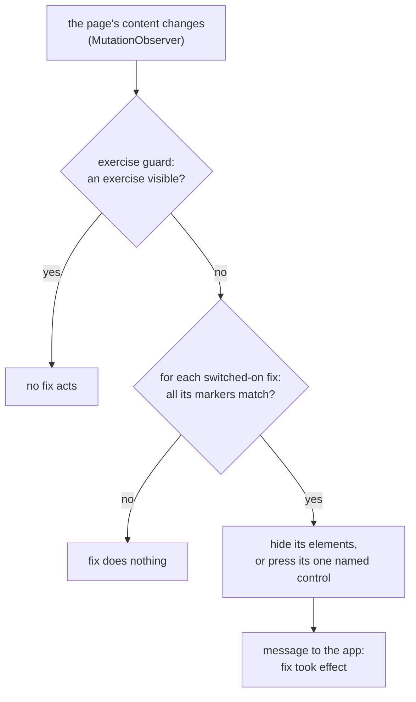

# ADR-0002: Fixes are data, applied by one engine that runs before the website's own scripts

- **Status:** Accepted
- **Date:** 2026-11-08
- **Decided by:** Thomas, 8 November 2026, in conversation, on Claude's brief

## Context

[ADR-0001](0001-android-webview.md) shows [the website](../glossary.md#the-website) in Android's [WebView](../glossary.md#webview), which can run the app's own CSS and JavaScript in the page. This record decides how [fixes](../glossary.md#fix) use that:

- [REQ-012](../requirements.md#req-012): hide a [non-exercise screen](../glossary.md#non-exercise-screen) wherever hiding lets the learner continue, press the website's own skip, continue or close control only where hiding would leave the lesson stuck, never touch an [exercise](../glossary.md#exercise), and leave a screen alone unless it is identified with confidence.
- [REQ-023](../requirements.md#req-023): each fix is defined apart from the rest of the app and names its requirement.
- [REQ-024](../requirements.md#req-024): fixes ship inside the app.
- [REQ-025](../requirements.md#req-025): a fix that no longer matches shows the website unchanged.
- [REQ-034](../requirements.md#req-034): a fix counts as working after 5 occasions on the [reference device](../glossary.md#reference-device).
- [REQ-042](../requirements.md#req-042): the app records when each fix last took effect, counted in lessons.
- [REQ-013](../requirements.md#req-013), [REQ-035](../requirements.md#req-035), [REQ-036](../requirements.md#req-036) and [REQ-037](../requirements.md#req-037) behave differently while a lesson is shown, which only the page can tell.

The website is a [single-page app](../glossary.md#single-page-app): a whole session usually loads one page, and the website's own script swaps the screens. Code that runs once when the page has loaded therefore misses every later screen. Fixes must keep watching the page. The browser's `MutationObserver` calls back whenever the page's content changes, much as `CollectionChanged` does for a collection in .NET.

Thomas's comparisons from WebView2, used below: injecting a script before the page's own is `AddScriptToExecuteOnDocumentCreatedAsync`; messages from the page to the app are `postMessage` and `WebMessageReceived`.

## Decision

**Fixes are data files, not code. One script, the [fix engine](../glossary.md#fix-engine), is injected before the website's own scripts, watches the page, and applies the switched-on fixes behind a single [exercise guard](../glossary.md#exercise-guard).**



1. **Injection.** The app registers the engine with `WebViewCompat.addDocumentStartJavaScript` from AndroidX WebKit, Google's add-on library for the WebView. The engine runs on every page of `https://duolingo.com` and `https://*.duolingo.com` before the website's own scripts, so the first screen is already fixed and nothing flashes. It reacts to every change the `MutationObserver` reports.
2. **The exercise guard.** Before any fix acts, the engine checks whether a visible exercise is on screen. If one is, no fix acts, whatever its own [markers](../glossary.md#marker) say. The guard lives in the engine, so no fix can leave it out. The markers that identify an exercise are kept in one data file, `fixes/exercise-markers.json`, and repaired like a fix. Duolingo's pages appear to label exercises with `data-test` attributes starting with `challenge`. This is to be confirmed on the reference device with the first fix.
3. **One fix = one JSON file**, e.g. `fixes/req-005-app-prompt.json`, read by the engine. It states the requirement it implements, whether it is a [disputed fix](../glossary.md#disputed-fix), its markers, its action, and after how many lessons without effect it counts as possibly broken ([REQ-042](../requirements.md#req-042)). A marker is an element selector, optionally with the text the element must contain. All markers must match before the fix acts. For example:

   ```json
   {
     "requirement": "REQ-005",
     "disputed": false,
     "markers": [{ "selector": "[data-test='app-promo']", "text": "Get the app" }],
     "action": "hide",
     "possiblyBrokenAfterLessons": 5
   }
   ```

   The selector and text are made up for this example.

4. **Two actions only.** `hide` tags the element the fix's first marker matches with an attribute that an injected stylesheet hides. Switching the fix off removes the tag. `press` clicks the one control the fix names. A press fix exists only where hiding would leave the lesson stuck ([REQ-012](../requirements.md#req-012)). Whoever reviews it checks that the control is a skip, continue or close control. A fix that needs anything else is not written as a one-off. Instead the engine gets a new action type, reviewed once for all fixes.
5. **Failing safe.** The engine runs each fix inside its own error handler. A fix that throws is switched off for the rest of the page. The website stays as it was ([REQ-025](../requirements.md#req-025)). The engine tells the app which fix failed and the kind of error, never page content. The app records it, flags the fix as failed on the settings screen and in the report, and shows on the menu button after the lesson that something is waiting ([REQ-042](../requirements.md#req-042)). Nothing is sent by itself ([REQ-020](../requirements.md#req-020)). A fix whose markers stop matching does nothing, which is the same outcome. If the engine itself fails, no fix runs and the website is shown unchanged. A malformed fix file is rejected by a check when the app is built, not on the phone.
6. **Talking to the app.** The page sends short messages to the app through `WebViewCompat.addWebMessageListener`, restricted to the same origins as the engine. The messages are: a fix took effect, a fix failed, a lesson started, a lesson ended. They never carry page content or account data ([REQ-036](../requirements.md#req-036), [REQ-042](../requirements.md#req-042)). The app uses "lesson started" and "lesson ended" for [REQ-013](../requirements.md#req-013), [REQ-035](../requirements.md#req-035), [REQ-036](../requirements.md#req-036) and [REQ-037](../requirements.md#req-037). In the other direction, the app gives the engine the list of switched-on fixes when it registers it, and registers it again after a settings change, before the reload of [REQ-018](../requirements.md#req-018).
7. **An unsupported WebView.** IF the phone's WebView lacks document-start scripts or the message listener, THEN the app applies no fixes and does not fall back to a later injection. It shows the screen of [REQ-048](../requirements.md#req-048) instead. Thomas decided this on 8 November 2026: without fixes the app has no purpose. The system requirements are stated before installing ([REQ-047](../requirements.md#req-047)).

## Alternatives considered

- **CSS only:** the strongest alternative for simplicity. One stylesheet hides elements by selector, nothing flashes, and a selector that stops matching hides nothing. It was set aside because CSS cannot press a control, so some screens could not be removed ([REQ-009](../requirements.md#req-009), [REQ-010](../requirements.md#req-010)). It cannot report that a fix took effect ([REQ-042](../requirements.md#req-042)) or that a lesson started. Its only check before acting would be the selector itself.
- **The same engine injected after the page has loaded** (`evaluateJavascript` in `onPageFinished`): the first screens would show before they are hidden. It has no other advantage, and the engine must watch the page anyway.
- **Each fix as its own script:** a fix could do anything, including leaving out the exercise guard or clicking inside an exercise. Reviewing a fix would mean reading code instead of a few lines of data.
- **A guard inside each fix:** one fix written without it would be enough to touch an exercise.
- **`addJavascriptInterface` for messages:** it exposes the app's methods to every page and frame the WebView loads, not only to duolingo.com.
- **Falling back to a later injection on an old WebView:** rejected by Thomas, 8 November 2026. A second injection path would need its own tests for a minority of phones, which [REQ-048](../requirements.md#req-048) serves better by telling the learner how to update.

## Consequences

- Easier: repairing a fix after Duolingo changes the website means editing one data file ([REQ-023](../requirements.md#req-023)). Reviewing a fix means reading a few lines of data.
- Easier: the exercise guard and the two actions are the only code that can act on the page. They are where tests must concentrate.
- Harder: a distraction drawn on top of a visible exercise stays visible. This is the cheaper failure [REQ-012](../requirements.md#req-012) asks for.
- Harder: the guard looks only at visible exercises. IF the website keeps earlier exercises in the page while they are hidden, THEN the guard must tell visible from hidden ones correctly. To be checked with the first fix.
- Follow-up: the first fix confirms on the reference device that `data-test` attributes identify exercises, and how the engine tells that a lesson started and ended.
- Follow-up: the WebView version that brings document-start scripts and the message listener feeds into the minimum Android version ([OPEN-D](../requirements.md#open-d)) and is stated by [REQ-047](../requirements.md#req-047).
- Follow-up: how the engine and the fixes are tested without copying Duolingo's pages into a public repository is left to its own [ADR](../glossary.md#adr), written with the first fix.
