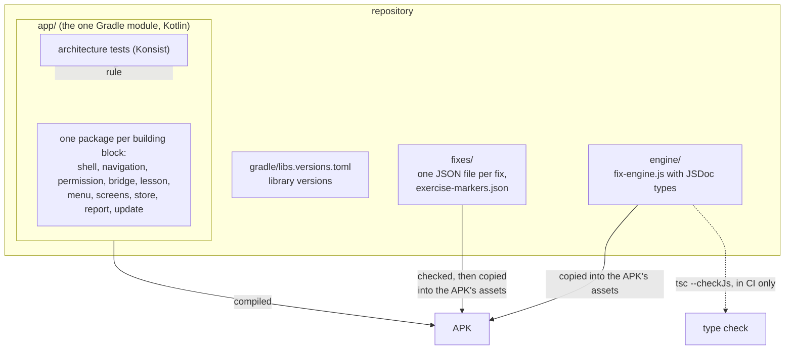

# ADR-0006: The app is one Kotlin module built with Gradle, with a JavaScript fix engine type-checked in CI

- **Status:** Accepted
- **Date:** 2026-11-09
- **Decided by:** Thomas, 9 November 2026, in conversation, on Claude's brief

## Context

Phase 0 of the [roadmap](../roadmap.md#phase-0-foundations) sets up an empty app that CI builds and tests. Before the first line of code, these questions must be settled. Most of them are expensive to change once code depends on them:

- what the app and the [fix engine](../glossary.md#fix-engine) are written in;
- how the code is split up, and how the [dependency rules](../architecture.md#dependency-rules) of the architecture are enforced;
- how the local store keeps settings, the status of each [fix](../glossary.md#fix) and marks;
- where the version lives, so that [release-please](../glossary.md#release-please) can still write it;
- the app's [application ID](../glossary.md#application-id) and how its own screens are drawn.

The requirements behind them:

- [REQ-022](../requirements.md#req-022): Android 10 and later ([ADR-0004](0004-minimum-android-10.md)).
- [REQ-043](../requirements.md#req-043): every release installs over the previous one and keeps sign-in and settings.
- [REQ-020](../requirements.md#req-020) and [REQ-042](../requirements.md#req-042): nothing leaves the phone unasked. The fix status holds no page content.
- [REQ-028](../requirements.md#req-028): F-Droid later ([OPEN-G](../requirements.md#open-g)), which builds every app from source on its own servers.
- [REQ-023](../requirements.md#req-023): fix files are checked when the app is built ([ADR-0002](0002-fix-engine.md)).
- [ADR-0003](0003-lesson-survives-switch.md): the window is never rebuilt, so every view of the app's own redraws itself after a configuration change.

Thomas knows C# and .NET, not [Kotlin](../glossary.md#kotlin) or Android. The two [spikes](../glossary.md#spike) were written in Kotlin and built with [Gradle](../glossary.md#gradle) and Microsoft OpenJDK 21 ([spike of 8 November 2026](../spikes/2026-11-08-lesson-survival.md)).

The version is not where the roadmap assumed. release-please's `simple` release type does not create `version.txt`: the open [release PR](../glossary.md#release-pr) changes only `.release-please-manifest.json` and `CHANGELOG.md`. Today the version therefore lives only in release-please's manifest.

## Decision

**The app is written in Kotlin and built with Gradle, as one [Gradle module](../glossary.md#gradle-module) with one package per building block. The fix engine is plain JavaScript, type-checked by TypeScript in CI. [Architecture tests](../glossary.md#architecture-test) enforce the dependency rules.**

1. **Kotlin and Gradle.** The app is written in Kotlin, Google's first-choice language for Android, as C# is for .NET. It is built with Gradle, which plays the part of MSBuild and NuGet restore together. The Gradle wrapper (`gradlew`) pins Gradle's version, as `global.json` pins the .NET SDK. Library and plugin versions are kept in one version catalog, `gradle/libs.versions.toml`, Gradle's counterpart of `Directory.Packages.props`. The build runs on Microsoft OpenJDK 21, as the spikes did.

2. **The fix engine is plain JavaScript, type-checked in CI.** The engine is written as `engine/fix-engine.js` with JSDoc type comments. A CI job runs `tsc --checkJs --noEmit` on it. This is like a Roslyn analyser: it reports misspelt fix-file fields and values that may be `null`, such as the result of `querySelector`, but produces nothing. The file the app ships is the source file. So the Gradle build needs no Node. Only the type check and, later, the engine's tests do. How the fix files are checked at build time ([ADR-0002](0002-fix-engine.md), point 5) is built in phase 2, on the same condition: the Gradle build needs no Node.

3. **One Gradle module, one package per building block.** The repository root holds the Gradle build (`settings.gradle.kts`, `build.gradle.kts`, the wrapper and the version catalog) next to `docs/` and `tools/`. Three folders hold the app:

   | Folder | Holds | .NET counterpart |
   |---|---|---|
   | `app/` | the one Gradle module: all Kotlin code, resources, `AndroidManifest.xml` and the Kotlin tests | one project in a solution |
   | `engine/` | the fix engine and the configuration of its type check | a folder of `wwwroot` scripts |
   | `fixes/` | one JSON file per [fix](../glossary.md#fix) and `exercise-markers.json` ([ADR-0002](0002-fix-engine.md)) | content files |

   Gradle copies `engine/` and `fixes/` into the [APK](../glossary.md#apk)'s assets. Inside `app/`, each building block of the [architecture](../architecture.md#5-building-blocks) is one package under `io.github.thomaswening.skipthefluff`: `shell`, `navigation`, `permission`, `bridge`, `lesson`, `menu`, `screens`, `store`, `report` and `update`. A package is a namespace. It sets no boundary by itself.

4. **Architecture tests enforce the dependency rules.** Each rule of the [architecture](../architecture.md#dependency-rules) becomes an [architecture test](../glossary.md#architecture-test) written with Konsist, a Kotlin library comparable to NetArchTest in .NET. The tests run with the other unit tests, so a broken rule fails the build. For example:

   | Rule | Checked as |
   |---|---|
   | Only the fix engine acts on the page | only the class in `shell` that registers the engine calls `addDocumentStartJavaScript`; no file calls `evaluateJavascript`, `addJavascriptInterface` or `loadUrl` with `javascript:` |
   | One block talks to the network | only `update` imports `java.net` or an HTTP library |
   | The native screens do not depend on [the website](../glossary.md#the-website) | `screens` imports nothing from `shell`, `bridge` or `lesson` |

   The rule that messages carry events, not content, is enforced by types as well. The four messages are one closed (sealed) Kotlin type, comparable to a C# record hierarchy whose constructors are private. Only `bridge` creates them from what the page sends.

5. **The local store is one typed document in [DataStore](../glossary.md#datastore).** Settings, fix status and marks are one Kotlin data class, comparable to a C# `record`. Jetpack DataStore saves it as one JSON file, written with kotlinx.serialization, in the app's private storage. Every write replaces the whole file atomically, so a crash never leaves half a file. Reads arrive as a stream of updates, like an `IObservable<T>`. A field added later gets a default value, so a store written by an older release still loads after an update ([REQ-043](../requirements.md#req-043)). Android's cloud backup and its transfer to a new phone are both switched off (`android:allowBackup="false"`, and `dataExtractionRules` excluding everything, which Android 12 and later read instead). Otherwise Android would copy the store and the sign-in cookies to Google Drive, which [REQ-020](../requirements.md#req-020) forbids. On a new phone the learner signs in again and sets the switches anew.

6. **The version lives in `app/build.gradle.kts`.** The line `versionName = "0.1.0" // x-release-please-version` holds it. release-please's generic updater, listed under `extra-files` in `release-please-config.json`, rewrites that line in every release PR, as it now rewrites the manifest. The `versionCode`, which Android compares to decide whether an APK is newer, is derived from `versionName` in the same file: major × 1,000,000 + minor × 1,000 + patch, e.g. 0.2.1 → 2,001. It rises with every release, which [REQ-043](../requirements.md#req-043) needs. No `version.txt` is created.

7. **The application ID is `io.github.thomaswening.skipthefluff`.** Together with the [signing key](../glossary.md#signing-key) it is the app's identity: Android installs an APK as an update only when both match the installed app. It never changes. The Kotlin packages use the same name as their root.

8. **The app's own screens are drawn with [Jetpack Compose](../glossary.md#jetpack-compose).** Compose redraws a screen by itself when the theme, the font size or the orientation changes. Thus the window survives such changes without rebuilding, as [ADR-0003](0003-lesson-survives-switch.md) requires. The [WebView](../glossary.md#webview) is placed inside the Compose window as one embedded Android view.

## Alternatives considered

- **.NET for Android (C#):** the strongest alternative, because Thomas knows the language. It was set aside because the APK would carry a .NET runtime of several MB. The bindings for AndroidX WebKit, on which [ADR-0002](0002-fix-engine.md) rests, follow Google's releases with a delay. F-Droid builds almost all its apps with Gradle ([OPEN-G](../requirements.md#open-g)).
- **Java:** works with every Android library, but is wordier than Kotlin. Android's documentation and samples have moved to Kotlin.
- **The fix engine in TypeScript, compiled in the Gradle build:** the same type safety as point 2. But every build of the app, including F-Droid's later, would then need Node and an npm install.
- **Plain JavaScript without a type check:** no toolchain at all. A misspelt field in a fix file or a forgotten `null` would only show on the phone.
- **Several Gradle modules, e.g. one per building block:** these work like separate .NET projects whose references the build checks. They were set aside because most of the dependency rules are about platform interfaces that every module can reach, such as `java.net` or the WebView's `evaluateJavascript`. Modules cannot forbid those, so the architecture tests would be needed anyway. Each module costs a build file and build time.
- **SharedPreferences:** Android's older key-value store. Untyped, and its writes are not atomic across several keys.
- **Room:** Android's SQLite library, comparable to Entity Framework Core. Far more than a dozen switches, a few counters per fix and a short list of marks need, with migrations to maintain.
- **Keeping `version.txt`, read by Gradle:** one more file, which release-please's `simple` type would have to be told to write. Putting the version in the build file keeps it where a reader of the build expects it, as `<Version>` in a `.csproj`.
- **Reading the version from `.release-please-manifest.json`:** that file is release-please's own state, not meant to be read by the build.
- **XML layouts (Android views):** the older way to draw screens, close to WPF's XAML. Because the window is never rebuilt, each screen would have to re-apply theme and font size by hand after every configuration change.

## Consequences

- Easier: one module and one build file to read. The structure of `app/` mirrors the building blocks of the architecture one to one.
- Easier: the Gradle build runs with nothing but a JDK and the Android SDK. Node is needed only by CI's type check, the docs check's Mermaid check and the engine's tests.
- Easier: a broken dependency rule fails the build, in CI and locally, with the rule's name.
- Harder: Thomas learns Kotlin, Gradle and Compose. [development.md](../development.md) explains each with its .NET counterpart when phase 0 adds the section on building and testing.
- Harder: package boundaries are only as strong as the architecture tests. A rule that has no test is not enforced.
- Harder: JSDoc type comments are wordier than TypeScript's own syntax.
- Follow-up (phase 0): set up the empty app with this structure, the `extra-files` entry in `release-please-config.json`, CI jobs for the Gradle build with its tests and for the type check, and the source and test globs of `tools/check_docs.py`.
- Follow-up (phase 2): the build-time check of fix files, under the condition of point 2. The testing [ADR](../glossary.md#adr) decides how the engine and the fixes are tested.
- Follow-up: whether F-Droid accepts the build as it is, including the switched-off backup, is checked when [OPEN-G](../requirements.md#open-g) is decided.
