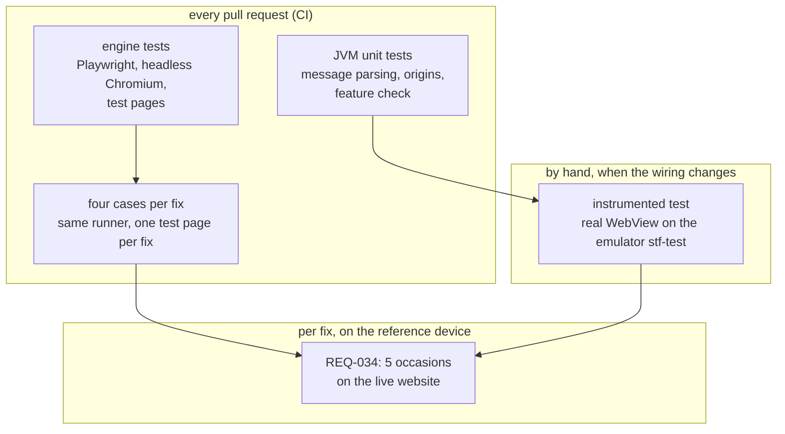

# ADR-0007: The engine and every fix are tested in headless Chromium on hand-written pages, never on copies of Duolingo's

- **Status:** Accepted
- **Date:** 2026-11-11
- **Decided by:** Thomas, 11 November 2026, in conversation, on Claude's brief

## Context

[ADR-0002](0002-fix-engine.md) made [fixes](../glossary.md#fix) data, applied by one [fix engine](../glossary.md#fix-engine) behind one [exercise guard](../glossary.md#exercise-guard). Its Consequences leave this record to decide how the engine, the guard and each fix are tested without copying Duolingo's pages into a public repository. Phase 2 of the [roadmap](../roadmap.md#phase-2-fix-engine-and-first-fix) needs the answer before the engine is built.

The requirements behind it:

- [REQ-012](../requirements.md#req-012): no fix ever acts on an [exercise](../glossary.md#exercise). A screen not identified with confidence is left alone. This is the guardrail the tests exist for.
- [REQ-023](../requirements.md#req-023): repairing a fix changes only that fix's definition.
- [REQ-024](../requirements.md#req-024): fixes ship inside the app.
- [REQ-025](../requirements.md#req-025): a fix that no longer matches, or that fails, leaves [the website](../glossary.md#the-website) unchanged.
- [REQ-034](../requirements.md#req-034): a fix counts as working after 5 occasions on the [reference device](../glossary.md#reference-device).
- [REQ-048](../requirements.md#req-048): a [WebView](../glossary.md#webview) without what the fixes need shows the app's own screen.

Three layers can fail, each in its own way:

| Layer | What can go wrong | .NET comparison |
|---|---|---|
| The engine and the guard, in JavaScript | the guard misses a visible exercise, or counts a hidden one; a fix that throws stops the others | unit tests of a library |
| Each fix, one JSON file | its [markers](../glossary.md#marker) match the wrong screen, or too little of the right one | a data-driven test, `[Theory]` with `[MemberData]` |
| The wiring in the WebView, in [Kotlin](../glossary.md#kotlin) | the engine is not injected, or its messages never reach the app | an integration test against the real WebView2 control |

The guard asks whether an exercise is **visible**. Visibility depends on layout: `display: none` on an ancestor, `visibility: hidden`, a size of zero. Only a browser engine computes layout. Android's WebView is built from Chromium, the engine of Chrome.

Duolingo's pages are Duolingo's work and may not be copied into the repository. Testing against the live website from CI would need an account's credentials and would be the automated access that Duolingo's terms forbid, which [REQ-012](../requirements.md#req-012)'s rationale relies on not doing. Only the live website can show whether a fix's markers still match. [REQ-034](../requirements.md#req-034) already checks that on the reference device.

## Decision

**The engine, the guard and every fix are tested with Playwright in headless Chromium, on small [test pages](../glossary.md#test-page) written by hand. Every fix must have a test page, and the suite runs the same four cases for each. The wiring in the real WebView is checked by an [instrumented test](../glossary.md#instrumented-test) on the emulator, run by hand when the wiring changes. Only the reference device shows that a fix matches the live website.**

An arrow means "is trusted only after". Each layer checks what the one before it cannot reach.

1. **Engine tests run in headless Chromium.** The runner is Playwright Test, Microsoft's browser-automation library (`Microsoft.Playwright` in .NET), pinned in `engine/package.json`. Headless means the browser runs without a window. A new CI job, `engine-tests`, runs beside `engine-types` in the [build workflow](../development.md#build-workflow) and blocks the merge when red. The [Gradle](../glossary.md#gradle) build stays free of Node, as [ADR-0006](0006-structure-and-build.md) requires. Each test loads a test page and injects the engine with `page.addInitScript`, which runs before the page's own scripts as `addDocumentStartJavaScript` does on the phone. The engine receives its list of switched-on fixes the way the app passes it ([ADR-0002](0002-fix-engine.md), point 6). An init script before the engine stands in for the app's end of the message channel and records every message. The engine's own tests cover at least:

   | Case | Expected |
   |---|---|
   | an exercise visible, a fix's markers match | no fix acts |
   | an exercise inside an ancestor with `display: none`, with `visibility: hidden`, or of size zero | counts as hidden; the fix acts |
   | an exercise appears after the fix acted | no further action from then on |
   | the exercise is removed again | the fix acts again |
   | one fix throws | it is switched off for the page; the other fixes still act; "fix failed" is sent with the kind of error and no page content |
   | a `press` fix | exactly its one named control is clicked, once |

2. **Test pages are written by hand, never copied.** A test page is a minimal HTML file under `engine/test/pages/`. It holds only what the markers and the guard read: the elements, their `data-test` attributes and the marker texts. It adds decoys that must not match, such as a similar element with other text. It never holds Duolingo's styles, scripts, images or any other text. Inline styles appear only where a test needs them, e.g. `display: none`. Each page starts with a comment saying which screen it stands for, the date it was observed and how: in the WebView's DevTools on the reference device (`chrome://inspect`, the F12 tools attached to the WebView). The marker texts are already in the fix files, so a test page carries nothing from Duolingo that the repository does not already hold. When the reference device shows that a test page no longer matches the real screen, the page is corrected in the same pull request as the fix.

3. **Every fix gets a test page and four generated cases.** The suite reads every fix in `fixes/` and expects a test page of the same name, e.g. `fixes/req-005-app-prompt.json` and `engine/test/pages/req-005-app-prompt.html`. A fix without a page fails the suite. For each fix, like a `[Theory]` over all fixes, it runs:

   1. **acts:** switched on, the fix hides its element or presses its control, and "fix took effect" is sent;
   2. **guard:** the same page with a visible exercise added, taken from `fixes/exercise-markers.json`: nothing happens;
   3. **one marker missing:** for each marker in turn, the page without it: nothing happens;
   4. **switched off:** nothing happens.

   A fix with a special situation adds hand-written tests on top. Adding a fix costs one JSON file and one test page.

4. **The Kotlin side is tested in the JVM on every pull request**, as in phase 1: which origins the engine and the message listener are registered for, how a message from the page becomes one of the four event types or is dropped, and what the feature check of [REQ-048](../requirements.md#req-048) decides when a feature is missing.

5. **The wiring in the real WebView is an instrumented test, run by hand.** An instrumented test runs inside the app on a device, like a UI test that drives the real WebView2 control. It uses the production code that registers the engine. It serves a test page at a duolingo.com address from inside the test, so it touches no network. It checks that the engine ran and that "fix took effect" reached the app, which needs no JavaScript of the test's own in the page. It runs with `gradlew connectedDebugAndroidTest` on the emulator `stf-test`. It is due before merging a pull request that changes the wiring. [development.md](../development.md) lists what counts, as it does for the [microphone check](../development.md#microphone-check).

6. **The live website is checked on the reference device only.** Each fix is accepted by [REQ-034](../requirements.md#req-034)'s 5 occasions and recorded in the [manual-verification record](../manual-verification.md). No automated test replaces this.

7. **Every test names the requirement it checks** in its title, e.g. `REQ-012: no fix acts while an exercise is visible`. The [docs check](../development.md#docs-check) gets the engine's test files in its `--tests` globs, so an ID that does not exist fails it.

## Alternatives considered

- **jsdom in Node:** the strongest alternative for speed and size. jsdom is a DOM written in JavaScript, with no layout engine. Testing with it is like testing a WPF visual tree that never ran Measure and Arrange: `ActualWidth` is always 0. "Visible" could not be tested, so the guard, the riskiest code, would be the part left untested.
- **Instrumented tests on the emulator for the engine:** closest to the phone. But every engine change would wait for an emulator to boot in CI, which takes minutes and is known to be flaky. Headless Chromium is the same engine, minus the version installed on the phone.
- **Real pages saved on Thomas's computer only**, in a folder git ignores: more realistic, but they age as fast as hand-written pages. They never run in CI, and a saved page holds account data.
- **The live website from CI:** needs an account's credentials as a secret, is flaky, and is the automated access Duolingo's terms forbid.
- **Tests written by hand for each fix:** full freedom, but nothing would force the guard and missing-marker cases, and every fix would repeat the same tests.
- **No tests per fix:** a misspelt marker would be found only on the phone.
- **The instrumented test in CI:** an emulator would boot in every pull request, for wiring that rarely changes. It can be added if the check by hand is ever forgotten.
- **The wiring checked on the reference device only:** a broken injection would show only as "no fix works", without saying where.

## Consequences

- Easier: the guard is tested where layout is real, on every pull request. A change to the engine that lets a fix act over a visible exercise fails CI.
- Easier: a new fix cannot merge without its test page, and the guard and missing-marker cases come with it for free.
- Easier: no Duolingo page and no account data enters the repository.
- Harder: CI downloads Chromium, about 150 MB, for the `engine-tests` job.
- Harder: headless Chromium is not the WebView version on a learner's phone. A difference between the two shows only on the reference device or in a report.
- Harder: a test page can drift from the real screen without any test failing. The fix's own status ([REQ-042](../requirements.md#req-042)) and the reference device catch this. The tests prove the engine's logic, not that the website still looks the same.
- Harder: the instrumented test depends on someone remembering to run it.
- Follow-up (phase 2, the engine's pull request): add Playwright to `engine/package.json`, the `engine-tests` job to `build.yml`, the engine's test glob to both docs-check calls, the `androidTest` setup to `app/build.gradle.kts`, and sections in [development.md](../development.md) for the engine tests and the instrumented test, with their rules, cases and "due when" list.
- Follow-up (phase 2, the first fix): its test page is the first written from DevTools on the reference device. It confirms what [ADR-0002](0002-fix-engine.md) left open: that `data-test` attributes identify exercises, and how hidden exercises are kept in the page. The guard's visibility cases are then adjusted to what was observed.
