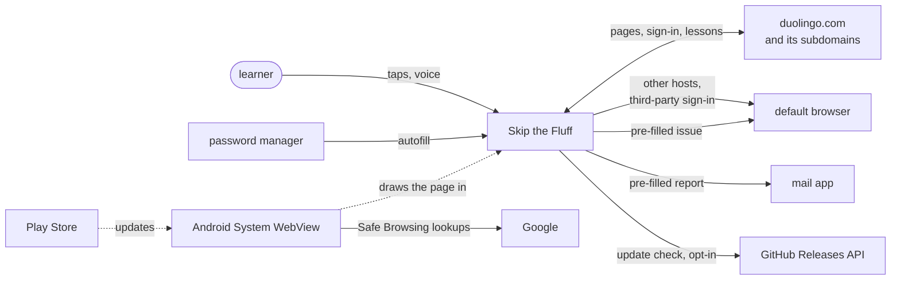
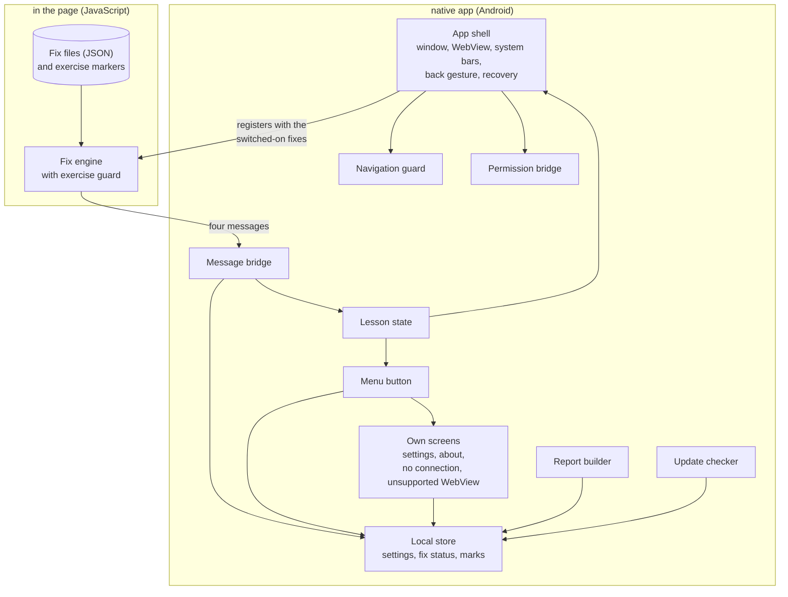
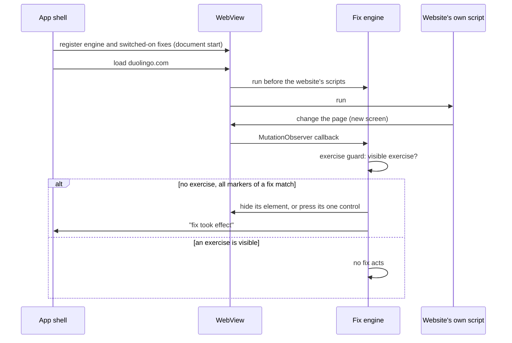
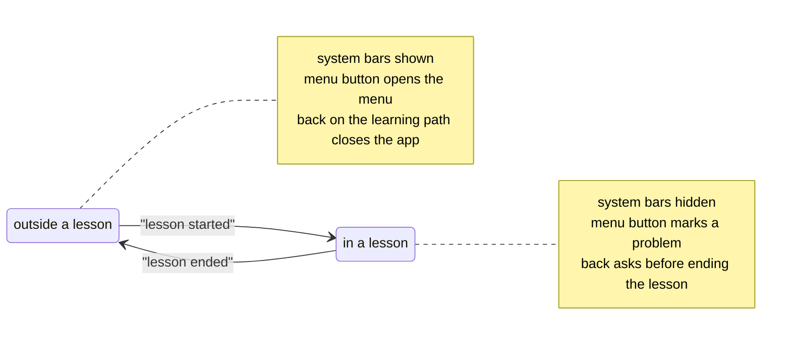

# Skip the Fluff: Architecture Overview
Draft | 8 November 2026 | Based on requirements v0.5

This document gives a high-level view of how Skip the Fluff is built and why. **What** the app must do is defined in [requirements.md](requirements.md). **When** each part is built is in the [roadmap](roadmap.md). The reasoning behind individual decisions is recorded in [architecture decision records](adr/README.md) ([ADRs](glossary.md#adr)), and measured evidence in [spikes](glossary.md#spike) (`docs/spikes/`).

Each part is marked **Implemented**, **Planned** (decided but not built yet) or **Open** (depends on an unresolved open decision or an ADR still to be written). On 8 November 2026 no app code exists, so only the repository's checks and [release-please](glossary.md#release-please) are Implemented.

## 1. Goals

Skip the Fluff lets a learner do Duolingo lessons on an Android phone through [the website](glossary.md#the-website), with the screens that do not serve learning removed ([REQ-001](requirements.md#req-001)).

The architecture is driven by these quality goals, in priority order:

| Priority | Quality goal | What it means here | Main requirements |
|---|---|---|---|
| 1 | **Never acts on learning** | No [fix](glossary.md#fix) touches an [exercise](glossary.md#exercise), a reward, a payment or a legal notice. A screen that cannot be identified with confidence is left alone. | [REQ-003](requirements.md#req-003), [REQ-012](requirements.md#req-012), [REQ-031](requirements.md#req-031), [REQ-008](requirements.md#req-008) |
| 2 | **Nothing leaves the phone unasked** | The app makes no network request of its own except the update check the learner allowed. It never reads the password. Records of fixes and marks hold no page content. | [REQ-020](requirements.md#req-020), [REQ-021](requirements.md#req-021), [REQ-036](requirements.md#req-036), [REQ-042](requirements.md#req-042) |
| 3 | **Fails safe** | A broken fix, a missing network or an unsuitable [WebView](glossary.md#webview) shows the website unchanged or the app's own screen. Nothing crashes. No lesson is blocked. | [REQ-025](requirements.md#req-025), [REQ-044](requirements.md#req-044), [REQ-048](requirements.md#req-048) |
| 4 | **A lesson flows** | Distractions are gone before they are seen. The lesson fills the screen and survives a short switch to another app. | [REQ-009](requirements.md#req-009), [REQ-010](requirements.md#req-010), [REQ-013](requirements.md#req-013), [REQ-014](requirements.md#req-014) |
| 5 | **Quick to repair** | When Duolingo changes the website, the broken fix is found from the learner's report and repaired in one data file. | [REQ-023](requirements.md#req-023), [REQ-033](requirements.md#req-033), [REQ-042](requirements.md#req-042) |
| 6 | **Trustworthy updates** | Every release installs over the previous one, is built from reviewed code and reaches the learner only through a release they install themselves. | [REQ-024](requirements.md#req-024), [REQ-040](requirements.md#req-040), [REQ-043](requirements.md#req-043) |

The order is derived from the requirements' rationales, not decided separately. When goals conflict, the higher one wins. For example, a popup drawn over a visible exercise stays visible, although removing it would help the lesson flow: goal 1 beats goal 4 ([ADR-0002](adr/0002-fix-engine.md), the [exercise guard](glossary.md#exercise-guard)). Likewise, fixes are not downloaded at run time, although that would repair them faster: goal 6 beats goal 5 ([REQ-024](requirements.md#req-024)).

## 2. Constraints

- **Platform:** Android phones with Android 10 (API level 29) or later. The minimum follows Chrome's support ([ADR-0004](adr/0004-minimum-android-10.md)). Accepted on the [reference device](glossary.md#reference-device), a Samsung Galaxy S25 FE ([REQ-022](requirements.md#req-022)).
- **Rendering:** Android's own WebView, kept up to date through the Play Store ([ADR-0001](adr/0001-android-webview.md)). The engine version is not under the project's control.
- **Language and build:** the app is written in [Kotlin](glossary.md#kotlin) and built with [Gradle](glossary.md#gradle) on Microsoft OpenJDK 21. The [fix engine](glossary.md#fix-engine) is plain JavaScript, which TypeScript type-checks in CI, so the Gradle build needs no Node ([ADR-0006](adr/0006-structure-and-build.md)).
- **No downloaded code:** fixes and the engine ship inside the [APK](glossary.md#apk) and change only with a release ([REQ-024](requirements.md#req-024)).
- **Distribution:** a signed APK on GitHub Releases, installed by [sideloading](glossary.md#sideloading). Not on the Play Store ([REQ-028](requirements.md#req-028)). Signed in CI with a key that only Thomas handles ([ADR-0005](adr/0005-signing-key.md)).
- **Legal:** GPL-3.0 only ([REQ-026](requirements.md#req-026)). No Duolingo branding ([REQ-027](requirements.md#req-027)). Duolingo's pages are not copied into the public repository, which constrains how fixes are tested (an ADR still to be written).
- **Developer:** one maintainer, Thomas, who knows C# and .NET but not Kotlin or Android. Choices favour few moving parts, documented platform mechanisms and code that reads like data where possible.

## 3. Context

Two external systems matter most. **The website** is the reason the app exists. Duolingo can change it at any time without notice, which is why fixes are data that can be repaired quickly ([section 5](#5-building-blocks)). **Android System WebView** draws the website inside the app. It updates by itself through the Play Store, so its behaviour can change between releases of Skip the Fluff. The app checks at start that it offers what the fix engine needs ([REQ-048](requirements.md#req-048)), and the report carries its version ([REQ-033](requirements.md#req-033)).

Everything the app sends to a third party goes through the learner: reports leave through the mail app or the browser, where the learner sends them themselves. The only request the app makes of its own accord is the update check to GitHub, and only once the learner has allowed it ([REQ-040](requirements.md#req-040)). The WebView's own [Safe Browsing](glossary.md#safe-browsing) lookups are allowed by [REQ-020](requirements.md#req-020).

## 4. Solution strategy

1. **A thin native shell around Android's WebView.** The app is one window that shows the website full screen, plus a few screens of its own. It relies on documented WebView settings for navigation, microphone, audio and [autofill](glossary.md#autofill), not on workarounds ([ADR-0001](adr/0001-android-webview.md)).
2. **Fixes are data, applied by one engine.** One JavaScript engine is injected before the website's own scripts. It reads one JSON file per fix and can only hide an element or press one named control ([ADR-0002](adr/0002-fix-engine.md)).
3. **One guard, in one place.** The exercise guard sits in the engine, in front of every fix. No fix can leave it out ([ADR-0002](adr/0002-fix-engine.md)).
4. **The page tells the app what happens, never what it shows.** Four short messages (a fix took effect, a fix failed, a lesson started, a lesson ended) are the only data that crosses from the page to the app ([ADR-0002](adr/0002-fix-engine.md)).
5. **Keep the page alive instead of saving it.** The window is never rebuilt and the [renderer process](glossary.md#renderer-process) keeps the app's priority in the background ([ADR-0003](adr/0003-lesson-survives-switch.md)).
6. **Fail towards the unchanged website.** Every error path ends in the website as Duolingo serves it, or in one of the app's own screens, never in a crash ([REQ-025](requirements.md#req-025), [ADR-0002](adr/0002-fix-engine.md), [ADR-0003](adr/0003-lesson-survives-switch.md)).
7. **Releases are built and signed from reviewed code.** release-please tags a release when Thomas merges the [release PR](glossary.md#release-pr). A CI job signs it in a protected environment after Thomas approves ([ADR-0005](adr/0005-signing-key.md)).

## 5. Building blocks

The blocks below are the app's logical parts. Each native block is one Kotlin package in the one [Gradle module](glossary.md#gradle-module) `app/`. The fix engine lives in `engine/`, the fix files in `fixes/` ([ADR-0006](adr/0006-structure-and-build.md)).

| Block | Responsibility | Status |
|---|---|---|
| **App shell** | The one window. Hosts the WebView, handles every configuration change itself, hides the system bars during lessons, maps the back gesture, keeps the renderer's priority, pauses and resumes the WebView, recovers from a lost renderer or a restarted app ([REQ-013](requirements.md#req-013), [REQ-014](requirements.md#req-014), [REQ-037](requirements.md#req-037), [REQ-045](requirements.md#req-045), [ADR-0003](adr/0003-lesson-survives-switch.md)). | Planned; orientation Open ([OPEN-H](requirements.md#open-h)) |
| **Navigation guard** | Lets navigations within the website through and hands every other host, and third-party sign-in, to the default browser ([REQ-015](requirements.md#req-015)). | Planned |
| **Permission bridge** | Asks Android for the microphone when the website asks for it and passes the answer on. Lets audio play without a tap ([REQ-038](requirements.md#req-038)). | Planned |
| **Fix engine** | The injected script. Watches the page, applies the exercise guard, runs each switched-on fix in its own error handler, sends the four messages ([REQ-012](requirements.md#req-012), [REQ-025](requirements.md#req-025), [ADR-0002](adr/0002-fix-engine.md)). | Planned |
| **Fix files** | One JSON file per fix, named after its requirement, and `exercise-markers.json` for the guard. Checked when the app is built ([REQ-023](requirements.md#req-023), [ADR-0002](adr/0002-fix-engine.md)). | Planned; the screens beyond [REQ-005](requirements.md#req-005) to [REQ-010](requirements.md#req-010) Open ([OPEN-A](requirements.md#open-a)) |
| **Message bridge** | Receives the engine's messages, only from duolingo.com origins, and passes them on. Rejects anything else ([ADR-0002](adr/0002-fix-engine.md)). | Planned |
| **Lesson state** | Knows whether a lesson is shown, from "lesson started" and "lesson ended". Drives the system bars, the menu button's mode and the back gesture ([REQ-013](requirements.md#req-013), [REQ-035](requirements.md#req-035), [REQ-037](requirements.md#req-037)). | Planned |
| **Menu button** | The small button over the website. Outside lessons it opens the menu. During lessons it is smaller and marks a problem. It shows that marks, failures or a new release are waiting ([REQ-035](requirements.md#req-035), [REQ-036](requirements.md#req-036), [REQ-040](requirements.md#req-040), [REQ-042](requirements.md#req-042)). | Planned |
| **Own screens** | Settings with a switch per fix and the update-check setting, the first-start dialog, about, no connection, unsupported WebView ([REQ-018](requirements.md#req-018), [REQ-019](requirements.md#req-019), [REQ-040](requirements.md#req-040), [REQ-044](requirements.md#req-044), [REQ-048](requirements.md#req-048)). | Planned |
| **Local store** | Keeps settings, per-fix status (lessons since last effect, failures) and marks on the phone only ([REQ-018](requirements.md#req-018), [REQ-036](requirements.md#req-036), [REQ-042](requirements.md#req-042)). Survives updates ([REQ-043](requirements.md#req-043)). One typed document in [DataStore](glossary.md#datastore), excluded from Android's cloud backup ([ADR-0006](adr/0006-structure-and-build.md)). | Planned |
| **Report builder** | Fills in the email or GitHub issue from versions, switched-on fixes, fix status and marks, and opens it in the mail app or browser ([REQ-033](requirements.md#req-033)). | Planned; report address Open ([OPEN-J](requirements.md#open-j)) |
| **Update checker** | Asks GitHub at most once a day, or when the learner presses the button, for the latest release and its minimum Android version ([REQ-040](requirements.md#req-040), [ADR-0004](adr/0004-minimum-android-10.md)). The only network code of the app's own. | Planned |
| **Release pipeline** | release-please opens the release PR and creates the release. A job in the `release` environment builds, signs and attaches the APK and the minimum-version file ([REQ-028](requirements.md#req-028), [REQ-043](requirements.md#req-043), [ADR-0005](adr/0005-signing-key.md)). | release-please Implemented; signing job Open (release workflow ADR) |
| **Docs check** | `tools/check_docs.py` and its workflows ([development.md](development.md#docs-check)). | Implemented |

Later releases add blocks for Google sign-in ([OPEN-B](requirements.md#open-b)), installing updates from the app ([OPEN-I](requirements.md#open-i)) and turning emailed reports into issues ([OPEN-K](requirements.md#open-k)). The last one runs outside the app.

### Dependency rules

- **Only the fix engine acts on the page.** Native code registers the engine and nothing else. It never runs other JavaScript in the page and never reads the page's content.
- **Fixes are data and depend only on the engine.** The engine knows no particular fix. A new kind of action is added to the engine, reviewed once, never written into a fix ([ADR-0002](adr/0002-fix-engine.md)).
- **Messages carry events, not content.** The message bridge accepts only the four message kinds, only from duolingo.com origins. Nothing that reaches the local store or the report comes from the page's content ([REQ-036](requirements.md#req-036), [REQ-042](requirements.md#req-042)).
- **One block talks to the network.** Apart from the WebView itself, only the update checker makes requests. The report builder hands its text to other apps and sends nothing ([REQ-020](requirements.md#req-020)).
- **The native screens do not depend on the website.** Settings, about, no connection and unsupported WebView work without a page loaded, so they stay reachable when the website does not ([REQ-044](requirements.md#req-044), [REQ-048](requirements.md#req-048)).

The fix files are checked when the app is built ([ADR-0002](adr/0002-fix-engine.md)). The other rules are [architecture tests](glossary.md#architecture-test) that run with the unit tests and fail the build, e.g. one that fails if any package but `update` imports `java.net`. The four messages are one closed Kotlin type that only the message bridge creates ([ADR-0006](adr/0006-structure-and-build.md)).

## 6. Key concepts

| Term | Meaning | Defined in |
|---|---|---|
| **The website** | duolingo.com and its subdomains, as served to a mobile browser | [requirements.md](requirements.md#requirement-conventions) conventions |
| **Exercise** and **[non-exercise screen](glossary.md#non-exercise-screen)** | a screen on which the learner answers, and every other screen in or around a lesson | [requirements.md](requirements.md#requirement-conventions) conventions |
| **Fix** and **[disputed fix](glossary.md#disputed-fix)** | one change to the website implementing one requirement; one that other learners may want to keep, shipped switched off | [requirements.md](requirements.md#requirement-conventions) conventions |
| **Fix engine** | the one injected script that applies fixes | [ADR-0002](adr/0002-fix-engine.md), [glossary](glossary.md#fix-engine) |
| **[Marker](glossary.md#marker)** | an element selector, optionally with text, that a fix needs on the page before it acts | [ADR-0002](adr/0002-fix-engine.md), [glossary](glossary.md#marker) |
| **Exercise guard** | the engine's check that no visible exercise is on screen before any fix acts | [ADR-0002](adr/0002-fix-engine.md), [glossary](glossary.md#exercise-guard) |
| **Lesson state** | whether a lesson is shown, as the engine reports it | this document, [section 5](#5-building-blocks) |
| **Fix status** | per fix, lessons since it last took effect and its last failure | [REQ-042](requirements.md#req-042) |
| **Mark** | the moment a learner tapped the menu button during a lesson, with the fix status at that time | [REQ-036](requirements.md#req-036) |

### Applying fixes

The website is a [single-page app](glossary.md#single-page-app): a session loads one page, and the website's own script swaps the screens. The engine therefore keeps watching the page instead of acting once.

A settings change registers the engine again with the new list of fixes and reloads the website ([REQ-018](requirements.md#req-018)). Settings cannot be opened during a lesson, so the reload never ends one.

### Lesson state

How the engine tells that a lesson started and ended is confirmed on the reference device with the first fix ([ADR-0002](adr/0002-fix-engine.md), Consequences).

### Keeping the lesson

The lesson lives only in the page's JavaScript memory. The app keeps it by never rebuilding its window and by keeping the renderer process as important as the app in the background ([ADR-0003](adr/0003-lesson-survives-switch.md)). This passed 5 of 5 switches to autoplaying Instagram stories on the reference device ([spike](spikes/2026-11-08-lesson-survival.md)). If Android ends the renderer or the app anyway, the app reloads the website at its last address. The lesson is then lost, but the learner is still signed in.

## 7. Cross-cutting concepts

- **Errors:** each error path ends in the unchanged website or one of the app's own screens ([REQ-025](requirements.md#req-025)). A fix that throws is switched off for the rest of the page, recorded with its kind of error and flagged after the lesson. An error the app shows names what went wrong and what the learner can do, such as "Try again" on the no-connection screen ([REQ-044](requirements.md#req-044)).
- **Privacy:** no analytics, crash reporting or advertising ([REQ-020](requirements.md#req-020)). The local store holds no page content and no account data. It leaves the phone only inside a report the learner sends ([REQ-042](requirements.md#req-042)).
- **Configuration changes:** rotation, dark mode, font size and language never rebuild the window. Each view of the app's own redraws itself for the new configuration ([ADR-0003](adr/0003-lesson-survives-switch.md)).
- **Network:** the WebView loads the website and makes its Safe Browsing lookups. The update checker is the app's only network code. No connection shows the app's own screen, with no automatic retry ([REQ-044](requirements.md#req-044)).
- **Versions in reports:** each report states the app version, the Android version and the WebView version, so a failure can be tied to the WebView update that caused it ([REQ-033](requirements.md#req-033)).
- **Language:** the interface and all documents are in English ([REQ-029](requirements.md#req-029)).
- **Testing:** **Open**, for the ADR on testing fixes and the engine without copying Duolingo's pages ([ADR-0002](adr/0002-fix-engine.md), Consequences). Whatever it decides, every test carries the ID of the requirement it checks, and `tools/check_docs.py` checks the IDs ([development.md](development.md#docs-check)). Requirements accepted on the reference device, such as [REQ-009](requirements.md#req-009) and [REQ-014](requirements.md#req-014), are checked by hand and listed in a manual-verification document.

## 8. Decisions

| ADR | Decision | Settles | Status |
|---|---|---|---|
| [0001](adr/0001-android-webview.md) | The website is shown in Android's own WebView | | Accepted |
| [0002](adr/0002-fix-engine.md) | Fixes are data, applied by one engine that runs before the website's own scripts | | Accepted |
| [0003](adr/0003-lesson-survives-switch.md) | The lesson survives an app switch because the app keeps its WebView and renderer process alive | | Accepted |
| [0004](adr/0004-minimum-android-10.md) | The minimum is Android 10 and follows Chrome's support | [OPEN-D](requirements.md#open-d) | Accepted |
| [0005](adr/0005-signing-key.md) | GitHub Actions signs releases with a key held in a protected environment and backed up twice off GitHub | | Accepted |
| [0006](adr/0006-structure-and-build.md) | The app is one Kotlin module built with Gradle, with a JavaScript fix engine type-checked in CI | | Accepted |

Still to be written, each briefed in conversation first:

| Decision | What it settles | Needed by |
|---|---|---|
| Testing fixes and the engine | how the engine, the guard and each fix are tested without Duolingo's pages in the repository | the first fix |
| The release workflow | the signing job, the minimum-version file attached to each release, the tested WebView version on the release page | the first release |

## 9. Risks

| Risk | Mitigation |
|---|---|
| Duolingo changes the website and fixes stop matching | A fix that stops matching does nothing ([REQ-025](requirements.md#req-025)). Fix status and reports point to the broken fix ([REQ-033](requirements.md#req-033), [REQ-042](requirements.md#req-042)). Repairing it means editing one data file. The update check brings the repair to learners ([REQ-040](requirements.md#req-040)). |
| The exercise guard misses an exercise, and a fix acts on it | Hiding comes before pressing ([REQ-012](requirements.md#req-012)). Press fixes are reviewed one by one. The guard's markers are data, repaired like a fix. Tests concentrate on the guard and the two actions ([ADR-0002](adr/0002-fix-engine.md)). |
| Duolingo serves a worse page to a WebView, or blocks it | The [user agent](glossary.md#user-agent) is left honest. A new ADR decides the response ([ADR-0001](adr/0001-android-webview.md), point 1). |
| A WebView update changes behaviour | The feature check at start shows [REQ-048](requirements.md#req-048)'s screen. Reports carry the WebView version. Each release states the version it was tested with ([REQ-047](requirements.md#req-047)). |
| Lessons are lost on phones with less memory than the reference device | The app recovers without crashing and keeps the sign-in. Reports reveal the problem. A [foreground service](glossary.md#foreground-service) is reconsidered by a new ADR if needed ([ADR-0003](adr/0003-lesson-survives-switch.md)). |
| The [signing key](glossary.md#signing-key) is lost or stolen | Two backups off GitHub, a published fingerprint and recorded plans for both cases ([ADR-0005](adr/0005-signing-key.md)). |
| Tests need Duolingo's pages, which may not be copied into a public repository | Left to the testing ADR, written with the first fix. |
| Duolingo objects to the project | No branding ([REQ-027](requirements.md#req-027)). The app hides rather than acts on the service ([REQ-012](requirements.md#req-012)) and never cheats ([REQ-003](requirements.md#req-003)). |
