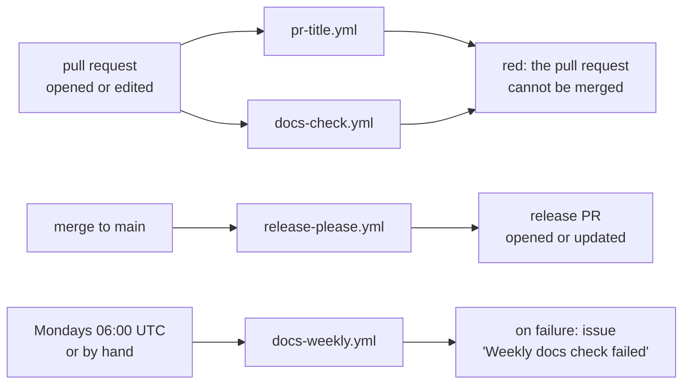

# Skip the Fluff: Development

How work on Skip the Fluff is done and checked. Sections on building, testing and signing are added with the first code, once the [ADR](glossary.md#adr) on the app's structure and build is written.

## Branches and pull requests

Decided by Thomas, 8 November 2026 (first elicitation pass, question 2).

- `main` changes only through pull requests. Nothing is committed to it directly, documents included.
- Work happens on short-lived branches named `<type>/<short-description>`, e.g. `feat/hide-app-prompt` or `docs/requirements-v0.3`. The type is a [Conventional Commits](glossary.md#conventional-commits) type.
- One pull request per change: a requirements pass, one ADR, one [fix](glossary.md#fix). Thomas reviews and merges every pull request.
- A pull request that implements or changes requirements names them as links, e.g. [REQ-005](requirements.md#req-005).
- Pull requests are [squash-merged](glossary.md#squash-merge). The repository allows no other merge method (set by Claude on Thomas's instruction, 8 November 2026). A merged branch is deleted automatically.

## Commits and changelog

- Every commit follows Conventional Commits: `type(scope): summary`, e.g. `feat(fixes): hide the "use the app" prompt` or `docs(requirements): v0.3, second elicitation pass`. The types are `feat`, `fix`, `perf`, `docs`, `test`, `refactor`, `build`, `ci` and `chore`. A breaking change adds `!` after the type or a `BREAKING CHANGE:` footer.
- Because pull requests are squash-merged, the **pull request's title** becomes the commit on `main`. The [PR-title check](#pr-title-check) makes sure it is a Conventional Commit.
- [release-please](glossary.md#release-please) reads the commits on `main`. It keeps a [release PR](glossary.md#release-pr) open with the next version and the new `CHANGELOG.md` entries.
- Versions follow [SemVer](glossary.md#semver), starting at 0.1.0. Before 1.0, `feat` raises the minor version (0.1.0 → 0.2.0) and `fix` the patch version (0.2.0 → 0.2.1). A breaking change also raises only the minor version.
- `feat`, `fix`, `perf` and `docs` appear in the changelog. `build`, `ci`, `test`, `refactor` and `chore` are hidden, since a learner reading the changelog does not need them.
- The version is written by release-please only. Until the app has a build file, it lives in `version.txt`. The build ADR moves it into the build file.

## Releases

- The release PR stays open and updates itself after every merge. Thomas merges it only when a release is intended. Merging it tags the commit `v0.x.y` and creates the GitHub release.
- Each release is a signed [APK](glossary.md#apk) on [GitHub Releases](https://github.com/thomaswening/skip-the-fluff/releases) ([REQ-028](requirements.md#req-028)). The workflow job that builds and attaches the APK, and how the signing key is kept, come with their ADRs.

## Writing documentation

Decided by Thomas, 8 November 2026, following the rules of his other projects.

- **Two layers.** Project records (requirements, [ADRs](glossary.md#adr), architecture, roadmap, this file) live in `docs/`. User documentation, such as the installation guide of [REQ-032](requirements.md#req-032), will live in `docs/user/`, sorted into tutorials, how-to guides, reference and explanation ([Diátaxis](https://diataxis.fr/)). Each subfolder is created with its first document.
- **Terms.** A term of art is linked to the [glossary](glossary.md) on its first use in each document, e.g. `[fix](glossary.md#fix)`. A new term gets a glossary entry in the same pull request that first uses it. <!-- glossary-ignore: term -->
- **No mathematics notation.** The documents need no formulas. Numbers and units are written in plain text ("within 1 second").
- **Language.** British English ([REQ-029](requirements.md#req-029)), sentence-case headings, absolute dates ("8 November 2026"), short declarative sentences.
- **Links.** Requirements, open decisions, ADRs and other documents are referred to by links, never by bare IDs or paths.
- **Diagrams.** Architecture, data flow and workflows get a Mermaid diagram. Measured results, such as timings for [REQ-009](requirements.md#req-009), get a chart.

## Tools and checks

Four GitHub workflows check pull requests and `main`. Each workflow file's header links its section here.



### PR-title check

`.github/workflows/pr-title.yml` runs [amannn/action-semantic-pull-request](https://github.com/amannn/action-semantic-pull-request) whenever a pull request is opened, edited, reopened or receives new commits. A red check blocks the merge.

**Rule: the pull request's title is a Conventional Commit.** The title becomes the commit on `main` when the pull request is squash-merged. release-please builds the version and the changelog from it, so a title it cannot read is lost from the changelog. The check reads only the title, not the branch's commits. The type must be one of the action's defaults: `feat`, `fix`, `docs`, `style`, `refactor`, `perf`, `test`, `build`, `ci`, `chore` or `revert`. The scope is optional.

| Title | Result | Why |
|---|---|---|
| `docs(requirements): v0.3, second elicitation pass` | accepted | type, scope and subject |
| `ci: add release-please and the docs check` | accepted | the scope is optional |
| `feat(fixes)!: rename the settings keys` | accepted | `!` marks a breaking change |
| `Requirements v0.3` | reported | no type |
| `feature: hide the app prompt` | reported | `feature` is not a type; write `feat` |
| `docs(requirements):v0.3` | reported | a space must follow the colon |

**When it fails:** edit the pull request's title on GitHub. The check runs again by itself. Nothing needs to be pushed.

### release-please

`.github/workflows/release-please.yml` runs [googleapis/release-please-action](https://github.com/googleapis/release-please-action) on every push to `main`, that is after every merge. Its settings are in `release-please-config.json`. The last released version is in `.release-please-manifest.json`. It checks nothing. It opens or updates the release PR, so a failure blocks no pull request.

When the release PR is merged, the same workflow creates the tag and the GitHub release.

**When it fails:** the run's log names the cause. The usual one is the repository setting "Allow GitHub Actions to create and approve pull requests" (Settings → Actions → General) being off. It was switched on by Claude on Thomas's instruction, 8 November 2026. A commit on `main` whose message is not a Conventional Commit is skipped without failing. It is then missing from the changelog, which can be fixed by editing the release PR's text before merging it.

### Docs check

`tools/check_docs.py` checks the documents for drift: broken links and anchors, requirement IDs that do not exist, ADRs out of step with their index, Mermaid diagrams that do not render, the requirements' version line, and terms that are not linked to the glossary. It is a copy of the checker in Thomas's claude-config repository (the `project-docs` skill), whose documentation describes every rule with its cases. `head -1 tools/check_docs.py` shows which version this copy is.

It runs in two workflows:

- `.github/workflows/docs-check.yml`, on every pull request, with `--base` set to the pull request's base branch. Every `error:` line blocks the merge. The glossary rules look only at the files the pull request changes.
- `.github/workflows/docs-weekly.yml`, on Mondays at 06:00 UTC on `main` and by hand (Actions → docs-weekly → Run workflow), with `--main`. It also checks every external link with [lychee](https://github.com/lycheeverse/lychee). On failure it opens the issue "Weekly docs check failed", or comments on the one still open. Whoever works on the project next fixes the findings in a pull request and closes the issue.

**When it fails:** each finding is one line, `error: <file>:<line>: <what is wrong>`. The usual fixes:

| Message | Fix |
|---|---|
| `link to missing file`, `link to missing anchor` | point the link at the file or heading as it is now; never change a glossary anchor to fix a link |
| `mentions REQ-nnn, which is not defined` | correct the ID, or define the requirement |
| `changed but its Version line did not`, `revision history has no new or changed row` | raise `Version:` in `requirements.md` and add a row to its revision history |
| `first use of 'X' is not linked to the glossary` | link that first use, e.g. `[APK](glossary.md#apk)` |
| `'X' looks like a term but is not in the glossary` | add a glossary entry, or a line with a reason to `docs/glossary-ignore.txt` for general vocabulary |
| `Mermaid diagram does not parse` | quote every node label, e.g. `a["f(x)"]`, and render the diagram again |

A glossary word used in its everyday sense is exempted where it occurs: `<!-- glossary-ignore: word -->` in that paragraph or list item.

**Running it locally** needs Python 3. Node's `npx` is needed for the Mermaid check. Without it, the check is skipped locally with a note.

```bash
python tools/check_docs.py . --base origin/main
```
