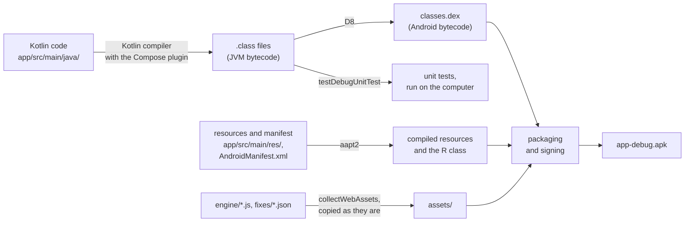
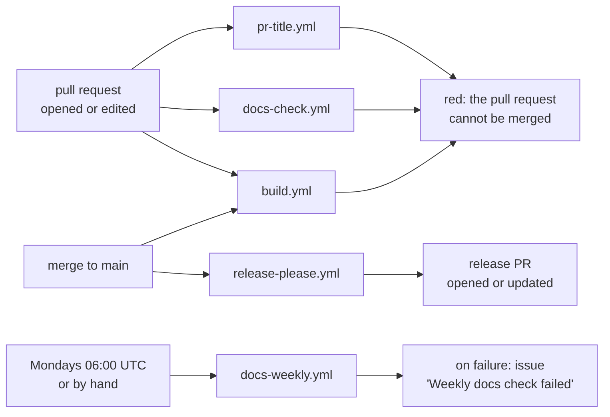
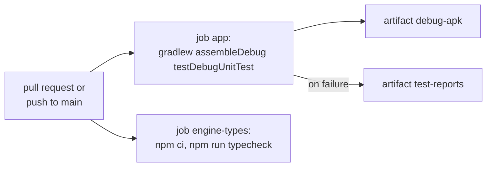

# Skip the Fluff: Development

How work on Skip the Fluff is done and checked. The app's structure and build follow [ADR-0006](adr/0006-structure-and-build.md). The section on signing releases is added with the release workflow's [ADR](glossary.md#adr).

## Branches and pull requests

Decided by Thomas, 8 November 2026 (first elicitation pass, question 2).

- `main` changes only through pull requests. Nothing is committed to it directly, documents included.
- Work happens on short-lived branches named `<type>/<short-description>`, e.g. `feat/hide-app-prompt` or `docs/requirements-v0.3`. The type is a [Conventional Commits](glossary.md#conventional-commits) type.
- One pull request per change: a requirements pass, one ADR, one [fix](glossary.md#fix). Thomas reviews and merges every pull request.
- A pull request that implements or changes requirements names them as links, e.g. [REQ-005](requirements.md#req-005).
- Pull requests are [squash-merged](glossary.md#squash-merge). The repository allows no other merge method (set by Claude on Thomas's instruction, 8 November 2026). A merged branch is deleted automatically.

## Commits and changelog

- Every commit follows Conventional Commits: `type(scope): summary`, e.g. `feat(fixes): hide the "use the app" prompt` or `docs(requirements): v0.3, second elicitation pass`. The types are `feat`, `fix`, `perf`, `docs`, `test`, `refactor`, `build`, `ci` and `chore`. A breaking change adds `!` after the type or a `BREAKING CHANGE:` footer.
- Because pull requests are squash-merged, the **pull request's title** becomes the commit on `main`. The [PR-title check](#pr-title-check) makes sure it is a Conventional Commit.
- [release-please](glossary.md#release-please) reads the commits on `main`. It keeps a [release PR](glossary.md#release-pr) open with the next version and the new `CHANGELOG.md` entries.
- Versions follow [SemVer](glossary.md#semver), starting at 0.1.0. Before 1.0, `feat` raises the minor version (0.1.0 → 0.2.0) and `fix` the patch version (0.2.0 → 0.2.1). A breaking change also raises only the minor version.
- `feat`, `fix`, `perf` and `docs` appear in the changelog. `build`, `ci`, `test`, `refactor` and `chore` are hidden, since a learner reading the changelog does not need them.
- The version is written by release-please only. It lives in `app/build.gradle.kts`, on the line marked `x-release-please-version` ([ADR-0006](adr/0006-structure-and-build.md)). The [version code](glossary.md#version-code) is derived from it, see [The version](#the-version).

## Releases

- The release PR stays open and updates itself after every merge. Thomas merges it only when a release is intended. Merging it tags the commit `v0.x.y` and creates the GitHub release.
- Each release is a signed [APK](glossary.md#apk) on [GitHub Releases](https://github.com/thomaswening/skip-the-fluff/releases) ([REQ-028](requirements.md#req-028)). The workflow job that builds and attaches the APK, and how the [signing key](glossary.md#signing-key) is kept, come with their ADRs.

## Writing documentation

Decided by Thomas, 8 November 2026, following the rules of his other projects.

- **Two layers.** Project records (requirements, [ADRs](glossary.md#adr), architecture, roadmap, this file) live in `docs/`. User documentation, such as the installation guide of [REQ-032](requirements.md#req-032), will live in `docs/user/`, sorted into tutorials, how-to guides, reference and explanation ([Diátaxis](https://diataxis.fr/)). Each subfolder is created with its first document.
- **Terms.** A term of art is linked to the [glossary](glossary.md) on its first use in each document, e.g. `[fix](glossary.md#fix)`. A new term gets a glossary entry in the same pull request that first uses it. <!-- glossary-ignore: term -->
- **No mathematics notation.** The documents need no formulas. Numbers and units are written in plain text ("within 1 second").
- **Language.** British English ([REQ-029](requirements.md#req-029)), sentence-case headings, absolute dates ("8 November 2026"), short declarative sentences.
- **Links.** Requirements, open decisions, ADRs and other documents are referred to by links, never by bare IDs or paths.
- **Diagrams.** Architecture, data flow and workflows get a Mermaid diagram. Measured results, such as timings for [REQ-009](requirements.md#req-009), get a chart.

## Building and testing

Set up in phase 0 of the [roadmap](roadmap.md#phase-0-foundations), 9 November 2026, as [ADR-0006](adr/0006-structure-and-build.md) decided. The app is written in [Kotlin](glossary.md#kotlin) and built with [Gradle](glossary.md#gradle). The [fix engine](glossary.md#fix-engine) is plain JavaScript and needs no build.

### How the sources become an APK

Gradle itself knows nothing about Android. The Android Gradle Plugin, declared in `gradle/libs.versions.toml`, adds the Android steps, as the .NET SDK adds its targets to MSBuild. `./gradlew assembleDebug` then runs these steps:



Each arrow is one tool. Every box is a set of files.

- **The Kotlin compiler** turns Kotlin into bytecode for the Java virtual machine (JVM), the counterpart of the .NET runtime. Roslyn turns C# into IL in the same way. The Compose plugin rewrites the functions that draw the screens.
- **D8** converts the JVM bytecode into Android's own bytecode, dex. Android does not run JVM bytecode. On the phone, Android's runtime compiles the dex to machine code, as the .NET runtime compiles IL.
- **aapt2** compiles the resources and the manifest. It generates the class `R`, through which the code names a resource, e.g. `R.string.app_name`. This is the counterpart of `Resources.Designer.cs` for a `.resx` file.
- **Packaging** zips everything into the [APK](glossary.md#apk) and signs it, for a debug build with the computer's debug key ([The debug build](#the-debug-build)).
- **The unit tests** run on the computer's JVM against the `.class` files. They need no phone and no dex.

### The parts and their .NET counterparts

What to read in a pull request: `app/build.gradle.kts`, `AndroidManifest.xml`, the Kotlin code and tests, `engine/fix-engine.js` and the workflows. Files marked *generated* below are written by a tool and never edited by hand. Like a NuGet lock file, they need no review.

| Here | What it is | .NET counterpart |
|---|---|---|
| `gradlew`, `gradlew.bat`, `gradle/wrapper/` | *generated* by `gradle wrapper`: the Gradle wrapper, which downloads and runs the one Gradle version the project pins in `gradle-wrapper.properties` | `global.json` plus the `dotnet` command |
| `settings.gradle.kts` | lists the modules and where libraries come from | the `.sln` file plus `nuget.config` |
| `build.gradle.kts` (root) | declares the plugins the modules may use | `Directory.Build.props` |
| `gradle/libs.versions.toml` | the version catalog: every library and plugin version, once | `Directory.Packages.props` |
| `app/` | the one [Gradle module](glossary.md#gradle-module): all Kotlin code, resources and tests | one project in the solution |
| `app/build.gradle.kts` | the module's build file: [application ID](glossary.md#application-id), Android versions, version, dependencies | the `.csproj` |
| `app/src/main/AndroidManifest.xml` | what Android must know before the app starts: the window, the permissions, backup switched off | `Package.appxmanifest` |
| `app/src/main/java/` | the Kotlin code, one package per building block of the [architecture](architecture.md#5-building-blocks) | the project's source folders, one namespace per folder |
| `app/src/main/res/` | resources: texts, the backup rules | `.resx` files |
| `app/src/test/` | unit tests, run on the computer, not on a phone, with JUnit 4 | a separate xUnit test project |
| `engine/fix-engine.js` | the fix engine, shipped as written | a script in `wwwroot` |
| `engine/package.json`, `engine/tsconfig.json` | the engine's type check, in CI only | a Roslyn analyser's configuration |
| `engine/package-lock.json` | *generated* by `npm install`: the exact versions of TypeScript and what it needs | `packages.lock.json` |
| `fixes/*.json` | one file per [fix](glossary.md#fix), shipped as written | content files |

```text
skip-the-fluff/
├── settings.gradle.kts, build.gradle.kts, gradlew   the Gradle build
├── gradle/libs.versions.toml                       versions
├── app/                                            the one module
│   ├── build.gradle.kts
│   └── src/
│       ├── main/java/io/github/thomaswening/skipthefluff/shell/          one package per block
│       └── test/java/io/github/thomaswening/skipthefluff/architecture/   architecture tests
├── engine/fix-engine.js                            copied into the APK as assets/engine/
└── fixes/*.json                                    copied into the APK as assets/fixes/
```

Gradle copies `engine/*.js` and `fixes/*.json` into the [APK](glossary.md#apk)'s assets with the task `collectWebAssets`, comparable to `CopyToOutputDirectory`. Nothing else in those folders goes into the app.

### What you need

- Microsoft OpenJDK 21, with `JAVA_HOME` pointing at it, e.g. `C:/Program Files/Microsoft/jdk-21.0.13.21-hotspot`. Gradle runs on it, as MSBuild runs on the .NET SDK.
- The Android SDK, e.g. in `%LOCALAPPDATA%/Android/Sdk`, with platform 36. Gradle finds it through `ANDROID_HOME` or through a file `local.properties` in the repository root with the line `sdk.dir=C:/Users/<you>/AppData/Local/Android/Sdk`. `local.properties` is not committed.
- Node 22, only for the engine's type check. The Gradle build does not need it.

The first build downloads Gradle and every library, about 1 GB, into `GRADLE_USER_HOME` (by default `~/.gradle`). This is Gradle's counterpart of the NuGet package cache.

### Building and running the tests

```bash
./gradlew assembleDebug testDebugUnitTest
```

`assembleDebug` builds the debug APK, `app/build/outputs/apk/debug/app-debug.apk`. `testDebugUnitTest` runs the unit tests, comparable to `dotnet test`. The test report is in `app/build/reports/tests/testDebugUnitTest/index.html`. In PowerShell, write `.\gradlew.bat` instead of `./gradlew`.

The [architecture tests](glossary.md#architecture-test) are unit tests too, written with Konsist, the Kotlin counterpart of NetArchTest. Each rule of the [architecture](architecture.md#dependency-rules) gets one test class named after the rule, in the package `architecture`. `NetworkAccessTest` is the pattern: it reads the production code and fails if any file outside the package `update` imports `java.net` or an HTTP library. A rule that has no test is not enforced.

### The debug build

A debug build is signed with the debug key committed in `app/debug.keystore`, not with the [signing key](glossary.md#signing-key) of the releases. Its application ID is `io.github.thomaswening.skipthefluff.debug` and its version ends in `-debug`. So it installs next to a release. With the release's own ID it would block the release's updates, because Android refuses an update signed with another key. It is a separate app with its own sign-in and settings.

Every computer and every CI run signs with the same committed debug key. Android installs an update only if it is signed with the same key as the installed app. With the key the Android SDK creates anew on each computer, each CI run would sign differently. Each debug build from a pull request would then need the previous one uninstalled first, and the phone would lose its sign-in each time. The debug key is not a secret: its password is `android`, as for every debug key. The debug build's own application ID keeps it from ever replacing a release. `.gitignore` ignores every other keystore (`*.p12`, `*.jks`, `*.keystore`), so the release key cannot be committed by mistake ([ADR-0005](adr/0005-signing-key.md)).

| Installed debug build | New debug build | Result |
|---|---|---|
| signed with the committed key | from any pull request or computer | installs over it; sign-in and settings stay |
| signed with an earlier key (before 10 November 2026) | signed with the committed key | refused as an update: uninstall the old one first, once |
| any | a release | installs next to it, because the IDs differ |

To install it on the phone, download the APK from a [build workflow](#build-workflow) run (the run's page, then Artifacts, then `debug-apk`, a zip that holds the APK) or build it locally. Then copy it to the phone and open it there, as for any [sideloaded](glossary.md#sideloading) app.

### The version

The version is the line `versionName = "0.1.0" // x-release-please-version` in `app/build.gradle.kts`. Only [release-please](glossary.md#release-please) changes it, in the [release PR](glossary.md#release-pr). Its generic updater, listed under `extra-files` in `release-please-config.json`, rewrites the version on every line marked `x-release-please-version`. It is the `<Version>` of a `.csproj`.

The [version code](glossary.md#version-code) is computed from it in the same file, by `versionCodeOf`: major × 1,000,000 + minor × 1,000 + patch.

| `versionName` | Version code | Result |
|---|---|---|
| `0.1.0` | 1,000 | accepted |
| `0.2.1` | 2,001 | accepted |
| `1.0.0` | 1,000,000 | accepted |
| `0.1000.0` | none | the build fails: minor and patch must stay below 1,000 |
| `0.2` | none | the build fails: the version is not major.minor.patch |

## Tools and checks

Five GitHub workflows check pull requests and `main`. Each workflow file's header links its section here.



### PR-title check

`.github/workflows/pr-title.yml` runs [amannn/action-semantic-pull-request](https://github.com/amannn/action-semantic-pull-request) whenever a pull request is opened, edited, reopened or receives new commits. A red check blocks the merge.

**Rule: the pull request's title is a Conventional Commit.** The title becomes the commit on `main` when the pull request is squash-merged. release-please builds the version and the changelog from it, so a title it cannot read is lost from the changelog. The check reads only the title, not the branch's commits. The type must be one of the action's defaults: `feat`, `fix`, `docs`, `style`, `refactor`, `perf`, `test`, `build`, `ci`, `chore` or `revert`. The scope is optional.

| Title | Result | Why |
|---|---|---|
| `docs(requirements): v0.3, second elicitation pass` | accepted | type, scope and subject |
| `ci: add release-please and the docs check` | accepted | the scope is optional |
| `feat(fixes)!: rename the settings keys` | accepted | `!` marks a breaking change |
| `Requirements v0.3` | reported | no type |
| `feature: hide the app prompt` | reported | `feature` is not a type; write `feat` |
| `docs(requirements):v0.3` | reported | a space must follow the colon |

**When it fails:** edit the pull request's title on GitHub. The check runs again by itself. Nothing needs to be pushed.

### release-please

`.github/workflows/release-please.yml` runs [googleapis/release-please-action](https://github.com/googleapis/release-please-action) on every push to `main`, that is after every merge. Its settings are in `release-please-config.json`. The last released version is in `.release-please-manifest.json`. It checks nothing. It opens or updates the release PR, so a failure blocks no pull request.

When the release PR is merged, the same workflow creates the tag and the GitHub release.

**When it fails:** the run's log names the cause. The usual one is the repository setting "Allow GitHub Actions to create and approve pull requests" (Settings → Actions → General) being off. It was switched on by Claude on Thomas's instruction, 8 November 2026. A commit on `main` whose message is not a Conventional Commit is skipped without failing. It is then missing from the changelog, which can be fixed by editing the release PR's text before merging it.

### Build workflow

`.github/workflows/build.yml` runs on every pull request and on every push to `main`. It has two jobs, which run side by side. A red job blocks the merge.



The job `app` sets up Microsoft OpenJDK 21 and Gradle, which caches the libraries between runs. It keeps the debug APK as the artifact `debug-apk` for 90 days. When it fails, it keeps the test reports as `test-reports`.

**Rule: the debug APK builds.** Kotlin that does not compile, a missing resource or a broken build file fails the job.

| Change | Result | Why |
|---|---|---|
| a Kotlin file that compiles | accepted | |
| a call to a function that does not exist | reported | compile error |
| `libs.okhttp` in `app/build.gradle.kts` without an entry in `gradle/libs.versions.toml` | reported | the catalog has no such entry |
| `versionName = "0.2"` | reported | `versionCodeOf` needs major.minor.patch |

**Rule: every unit test passes, the architecture tests included.**

| Change | Result | Why |
|---|---|---|
| a file in `update` that imports `java.net.URL` | accepted | the network rule allows it there |
| a file in `shell` that imports `java.net.URL` | reported | `NetworkAccessTest`: only `update` may talk to the network |
| a unit test whose assertion fails | reported | |

**When it fails:** the log of the step "Build the debug APK and run the tests" names the file and line of a compile error. A failed test is named above `> Task :app:testDebugUnitTest FAILED`. An architecture test also names the rule and the files that break it, e.g. `Assert 'only the update package imports java_net or an HTTP library' was violated`. Download `test-reports` for the full report. Fix the code, not the test. A test changes only when its rule changed, which needs the ADR or the [architecture](architecture.md#dependency-rules) changed first.

**Running it locally:** see [Building and running the tests](#building-and-running-the-tests).

### Engine type check

The job `engine-types` of the [build workflow](#build-workflow) runs TypeScript's compiler over `engine/fix-engine.js` without producing anything (`tsc` with `checkJs` and `noEmit`, set in `engine/tsconfig.json`). It reads the types from the JSDoc comments, e.g. `@typedef` and `@type`. It works like a Roslyn analyser with warnings treated as errors. The TypeScript version is pinned in `engine/package.json` and `engine/package-lock.json`.

**Rule: the engine type-checks in strict mode.**

| Code | Result | Why |
|---|---|---|
| `action: "hide"` in a value of type `Fix` | accepted | `action` is `"hide"` or `"press"` |
| `action: "hid"` | reported | `Type '"hid"' is not assignable to type '"hide" \| "press"'` |
| `document.querySelector("a").click()` | reported | `Object is possibly 'null'`: check the result first |
| `const link = document.querySelector("a"); if (link) link.click();` | accepted | the check rules out `null` |
| a function parameter without a JSDoc `@param` type | reported | strict mode forbids an implicit `any` |

**When it fails:** each finding is one line, `fix-engine.js(line,column): error TSnnnn: <what is wrong>`. Correct the code or its JSDoc type. Do not switch off `strict` or add `// @ts-ignore`.

**Running it locally** needs Node 22:

```bash
cd engine && npm ci && npm run typecheck
```

### Docs check

`tools/check_docs.py` checks the documents for drift: broken links and anchors, requirement IDs that do not exist, ADRs out of step with their index, Mermaid diagrams that do not render, the requirements' version line, and terms that are not linked to the glossary. It is a copy of the checker in Thomas's claude-config repository (the `project-docs` skill), whose documentation describes every rule with its cases. `head -1 tools/check_docs.py` shows which version this copy is.

It runs in two workflows:

- `.github/workflows/docs-check.yml`, on every pull request, with `--base` set to the pull request's base branch. Every `error:` line blocks the merge. The glossary rules look only at the files the pull request changes.
- `.github/workflows/docs-weekly.yml`, on Mondays at 06:00 UTC on `main` and by hand (Actions → docs-weekly → Run workflow), with `--main`. It also checks every external link with [lychee](https://github.com/lycheeverse/lychee). On failure it opens the issue "Weekly docs check failed", or comments on the one still open. Whoever works on the project next fixes the findings in a pull request and closes the issue.

**When it fails:** each finding is one line, `error: <file>:<line>: <what is wrong>`. The usual fixes:

| Message | Fix |
|---|---|
| `link to missing file`, `link to missing anchor` | point the link at the file or heading as it is now; never change a glossary anchor to fix a link |
| `mentions REQ-nnn, which is not defined` | correct the ID, or define the requirement |
| `changed but its Version line did not`, `revision history has no new or changed row` | raise `Version:` in `requirements.md` and add a row to its revision history |
| `first use of 'X' is not linked to the glossary` | link that first use, e.g. `[APK](glossary.md#apk)` |
| `'X' looks like a term but is not in the glossary` | add a glossary entry, or a line with a reason to `docs/glossary-ignore.txt` for general vocabulary |
| `Mermaid diagram does not parse` | quote every node label, e.g. `a["f(x)"]`, and render the diagram again |

A glossary word used in its everyday sense is exempted where it occurs: `<!-- glossary-ignore: word -->` in that paragraph or list item.

**External links** (weekly only) follow one rule: every external link in `README.md` and `docs/` answers with a success status. A link whose site refuses automated clients is exempted by a line in `.lycheeignore` with the reason and the date it was checked in a browser. It is then checked by hand only.

| lychee reports | Fix |
|---|---|
| `[404]`, or a host that does not resolve | the page is gone: link its new address or an archived copy, e.g. on the Wayback Machine |
| `[403]` or `[429]` for a page that loads in a browser | the site blocks automated clients: add its address to `.lycheeignore` with the reason and the date |
| `[403]` or `[429]` for a page that does not load in a browser either | the page is gone: treat it as a 404 |
| the step fails before any link is checked, e.g. `curl` exit 22 while installing lychee | a download hiccup, not a finding: run the workflow again by hand and close the issue if it passes |

**Running it locally** needs Python 3. Node's `npx` is needed for the Mermaid check. Without it, the check is skipped locally with a note.

```bash
python tools/check_docs.py . --base origin/main --source "*.kts" "app/*.kts" "gradle/*.toml" "app/src/main/**/*.kt" "app/src/main/**/*.xml" "engine/*.js" --tests "app/src/test/**/*.kt" --markdown "fixes/*.md" --repo-url https://github.com/thomaswening/skip-the-fluff
```

The globs are the same as in `docs-check.yml`. `--source` and `--tests` name the code whose links into `docs/` and whose requirement and ADR IDs are checked. A test that names a requirement ID that does not exist fails the check, e.g. `names REQ-099, which is not defined`. An ID in a code comment without a link to its definition is a warning.
