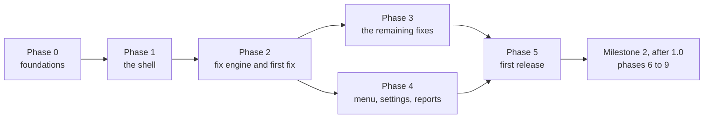

# Skip the Fluff: Implementation Roadmap
Draft | 8 November 2026 | Based on requirements v0.5

This document says in which order Skip the Fluff is built. **What** it must do is in [requirements.md](requirements.md), **how** it is built in the [architecture overview](architecture.md), and **why** in the [architecture decision records](adr/README.md) ([ADRs](glossary.md#adr)).

## Principles

- **Risky foundations first.** The parts that could make the whole project fail are proven before anything depends on them: that the lesson survives an app switch ([REQ-014](requirements.md#req-014)), and that the [fix engine](glossary.md#fix-engine) can tell an [exercise](glossary.md#exercise) from a [non-exercise screen](glossary.md#non-exercise-screen) on the real website ([REQ-012](requirements.md#req-012)). The menu, settings and reports come after them.
- **Every phase ends with something runnable**: a debug [APK](glossary.md#apk) that Thomas installs on the [reference device](glossary.md#reference-device) and uses for his morning session.
- **Open decisions are resolved just before the phase that needs them**, not all up front. The "Needs" line of each phase lists which ones. A phase is not complete until they are recorded in [section 10 of the requirements](requirements.md#open-decisions) or in an ADR.
- **Guardrails are verified automatically on every change.** From phase 0, each phase adds tests for its requirements, tagged with their IDs, and CI must pass before merging ([development.md](development.md)). What cannot be automated, such as [REQ-009](requirements.md#req-009)'s timing on the reference device, goes into the [manual-verification record](manual-verification.md) and is checked before each release.
- **What never happens, in any phase**: answering or skipping exercises, changing rewards, unlocking paid features, touching consent or legal notices ([REQ-003](requirements.md#req-003), [REQ-031](requirements.md#req-031)). Every [fix](glossary.md#fix) is reviewed against these.

Phases 3 and 4 depend only on phase 2, so their work can interleave.

## Milestone 1 — First release

### Phase 0: Foundations

[ADR-0006](adr/0006-structure-and-build.md) decided the language, the modules and how the [dependency rules](architecture.md#dependency-rules) are enforced. An empty app is set up with its [application ID](glossary.md#application-id), `minSdk` 29 and the version in the build file, written by [release-please](glossary.md#release-please). CI builds a debug APK and runs the tests on every pull request. `tools/check_docs.py` is given the source and test globs, so that a test tagged with a requirement ID that does not exist fails the check. The section on building and testing in [development.md](development.md) is written, with the .NET comparisons Thomas needs.

- Requirements: [REQ-022](requirements.md#req-022), [REQ-029](requirements.md#req-029)
- Resolves: the structure and build ADR ([ADR-0006](adr/0006-structure-and-build.md))
- Needs: nothing

### Phase 1: The shell

The app shows [the website](glossary.md#the-website) full screen in Android's [WebView](glossary.md#webview), as the [spikes](glossary.md#spike) did, but built to last. It leaves room for the system bars, keeps its window across configuration changes, keeps the [renderer process](glossary.md#renderer-process)'s priority and recovers when it is lost ([ADR-0003](adr/0003-lesson-survives-switch.md)). Links to other hosts and third-party sign-in open in the default browser. The microphone, audio, sign-in, [autofill](glossary.md#autofill) and the back gesture work. A learner who refused the microphone is told where to switch it on. A missing network shows the app's own screen. Thomas checks whether the website can be used in landscape, which decides how orientation behaves. At the end of this phase the app is Chrome without its browser interface, with no fixes yet. [REQ-014](requirements.md#req-014)'s full measurement is repeated here, including a rotation and a dark-mode switch during the lesson.

- Requirements: [REQ-004](requirements.md#req-004), [REQ-013](requirements.md#req-013) (outside lessons), [REQ-014](requirements.md#req-014), [REQ-015](requirements.md#req-015), [REQ-016](requirements.md#req-016), [REQ-021](requirements.md#req-021), [REQ-037](requirements.md#req-037) (outside lessons), [REQ-038](requirements.md#req-038), [REQ-039](requirements.md#req-039), [REQ-049](requirements.md#req-049), [REQ-044](requirements.md#req-044), [REQ-045](requirements.md#req-045)
- Resolves: nothing
- Needs: [OPEN-H](requirements.md#open-h), for orientation only; resolved at the start of the phase, 9 November 2026: the website can be used in landscape

### Phase 2: Fix engine and first fix

[ADR-0007](adr/0007-testing-fixes.md) decided how the engine, the [exercise guard](glossary.md#exercise-guard) and each fix are tested without copying Duolingo's pages into the repository. Then the engine is built as [ADR-0002](adr/0002-fix-engine.md) describes, with the check of fix files at build time, the message bridge and the feature check of [REQ-048](requirements.md#req-048). The first fix is the "use the app" prompt of [REQ-005](requirements.md#req-005), because it appears after every session and is easy to observe. With it, the reference device confirms what [ADR-0002](adr/0002-fix-engine.md) left to the first fix: that `data-test` attributes identify exercises, that the guard tells visible from hidden exercises, and how the engine tells that a lesson started and ended. The lesson state then hides the system bars during lessons and makes the back gesture ask before ending a lesson.

The engine gets only the `hide` action in this phase, because the first fix needs nothing else. `press` and its engine test come in the pull request of the first fix whose screen cannot be hidden without leaving the lesson stuck ([REQ-012](requirements.md#req-012)). Thomas decided this on 12 November 2026: code that no fix uses would go untested on the reference device, and `press` is the riskier action.

This is the riskiest phase. IF the guard cannot identify exercises with confidence, THEN no fix may act ([REQ-012](requirements.md#req-012)), and the project needs a new ADR before going further.

- Requirements: [REQ-005](requirements.md#req-005), [REQ-012](requirements.md#req-012), [REQ-013](requirements.md#req-013) (during lessons), [REQ-023](requirements.md#req-023), [REQ-024](requirements.md#req-024), [REQ-025](requirements.md#req-025), [REQ-034](requirements.md#req-034), [REQ-037](requirements.md#req-037) (during lessons), [REQ-048](requirements.md#req-048)
- Resolves: the testing ADR ([ADR-0007](adr/0007-testing-fixes.md)); the follow-ups of [ADR-0002](adr/0002-fix-engine.md)
- Needs: nothing beyond phase 1

### Phase 3: The remaining fixes

One pull request per fix: leaderboard and league popups, streak and reminder nags, Super and Max upsells (leaving the out-of-hearts screen alone), the unit-completion animation within 1 second, and the listening-lesson intro with its ["important words" preview](glossary.md#important-words-preview). Each fix is accepted on 5 occasions on the reference device ([REQ-034](requirements.md#req-034)). Screens Thomas reports with a screenshot in the meantime become requirements and fixes in the same way, the puzzle animation first. Each says whether it is a [disputed fix](glossary.md#disputed-fix).

A fix is built only after Thomas has seen its screen in the debug app and taken a screenshot, as [OPEN-A](requirements.md#open-a) already asks for new screens. Its [markers](glossary.md#marker) and its [test page](glossary.md#test-page) come from that screen in DevTools on the reference device ([ADR-0007](adr/0007-testing-fixes.md), point 2). Thomas decided this on 12 November 2026: by then he had seen only the "use the app" prompt in the debug app, none of the screens above.

- Requirements: [REQ-006](requirements.md#req-006), [REQ-007](requirements.md#req-007), [REQ-008](requirements.md#req-008), [REQ-009](requirements.md#req-009), [REQ-010](requirements.md#req-010), [REQ-011](requirements.md#req-011)
- Resolves: nothing
- Needs: [OPEN-A](requirements.md#open-a), one screen at a time; collected continuously

### Phase 4: Menu, settings and reports

The app's own parts around the website: the menu button, with its smaller lesson mode that marks a problem, also shown over the no-connection screen of [REQ-044](requirements.md#req-044); the settings screen with a switch per fix and the reload after a change; the about screen; the fix status, counted in lessons, and failures recorded by the engine; the report by email or GitHub issue, with the warning about screenshots; the opt-in update check, its first-start dialog and the "Check for updates now" button. At the end of this phase every network request the app makes is checked against [REQ-020](requirements.md#req-020).

- Requirements: [REQ-018](requirements.md#req-018), [REQ-019](requirements.md#req-019), [REQ-020](requirements.md#req-020), [REQ-033](requirements.md#req-033), [REQ-035](requirements.md#req-035), [REQ-036](requirements.md#req-036), [REQ-040](requirements.md#req-040), [REQ-042](requirements.md#req-042)
- Resolves: nothing
- Needs: [OPEN-J](requirements.md#open-j) (the report address), before the report is built

### Phase 5: First release

The ADR on the release workflow decides the signing job in the `release` environment ([ADR-0005](adr/0005-signing-key.md)), the minimum-version file attached to each release ([ADR-0004](adr/0004-minimum-android-10.md)) and how the release page is written. Thomas generates the [signing key](glossary.md#signing-key) and its backups and stores the secrets. The README gets the installation, system requirements, update and report sections and the key's fingerprint. The installation guide is written with screenshots from the reference device. A volunteer who has never [sideloaded](glossary.md#sideloading) an app tests it. Before release, two release-signed builds from this phase are installed one over the other to check that sign-in and settings survive. Every manual check is done on the reference device and recorded.

- Requirements: [REQ-002](requirements.md#req-002), [REQ-026](requirements.md#req-026), [REQ-027](requirements.md#req-027), [REQ-028](requirements.md#req-028), [REQ-030](requirements.md#req-030), [REQ-032](requirements.md#req-032), [REQ-043](requirements.md#req-043), [REQ-047](requirements.md#req-047)
- Resolves: the release workflow ADR (to be written)
- Needs: a volunteer for [REQ-032](requirements.md#req-032)'s test, found before this phase starts

### First release

Thomas merges the [release PR](glossary.md#release-pr) and approves the signing job. The release has every SHALL and SHOULD of [sections 1 to 9 of the requirements](requirements.md#1-purpose-and-users) that is not a COULD. It ships with these interim behaviours:

- Google, Facebook and Apple sign-in open in the default browser ([REQ-015](requirements.md#req-015)), so learners sign in with email and password.
- Updates are installed by downloading the APK in the browser, as in the installation guide.
- Emailed reports are copied into issues by hand.

Not yet implemented: Google sign-in ([REQ-017](requirements.md#req-017)), installing updates from the app ([REQ-041](requirements.md#req-041)), emailed reports becoming issues automatically ([REQ-046](requirements.md#req-046)) and distribution through F-Droid ([REQ-028](requirements.md#req-028)).

The version number of the first release is [release-please](glossary.md#release-please)'s, from the commits merged by then. When to call a release 1.0 is Thomas's decision and is not tied to a phase.

## Milestone 2 — After 1.0

Each of these is a COULD and starts with its open decision. The phases are numbered for reference only: their order is decided when Milestone 1 is done.

### Phase 6: Google sign-in

- Requirements: [REQ-017](requirements.md#req-017)
- Needs: [OPEN-B](requirements.md#open-b)

### Phase 7: F-Droid

- Requirements: [REQ-028](requirements.md#req-028)
- Needs: [OPEN-G](requirements.md#open-g)

### Phase 8: Installing updates from the app

- Requirements: [REQ-041](requirements.md#req-041)
- Needs: [OPEN-I](requirements.md#open-i)

### Phase 9: Emailed reports become issues

- Requirements: [REQ-046](requirements.md#req-046)
- Needs: [OPEN-K](requirements.md#open-k)

## Open decisions by phase

| Decision | Needed before |
|---|---|
| The app's structure and build ([ADR-0006](adr/0006-structure-and-build.md), decided 9 November 2026) | Phase 0 |
| [OPEN-H](requirements.md#open-h) (resolved 9 November 2026: landscape works) | Phase 1 (orientation) |
| Testing fixes and the engine ([ADR-0007](adr/0007-testing-fixes.md), decided 11 November 2026) | Phase 2 |
| [OPEN-A](requirements.md#open-a) | Phase 3, each new fix; collected continuously |
| [OPEN-J](requirements.md#open-j) | Phase 4 (the report) |
| The release workflow (ADR to be written) | Phase 5 |
| [OPEN-B](requirements.md#open-b) | Phase 6 |
| [OPEN-G](requirements.md#open-g) | Phase 7 |
| [OPEN-I](requirements.md#open-i) | Phase 8 |
| [OPEN-K](requirements.md#open-k) | Phase 9 |
